<div align="center">

# 📚 01-pjt

### JSON 도서 데이터 🔍 파싱하고 필터링하기

알라딘 도서 JSON 파일을 불러와 필요한 값만 꺼내고, 조건에 따라 <br>
분류·집계·정렬해보는 SSAFY 16기 첫 번째 관통 프로젝트

<br>


`YYYY.MM.DD` · 팀 프로젝트 (Fork & PR 협업)

</div>

<br>

## 🗂️ 진행 범위

| 그룹 | 문제 | 상태 |
| :---: | --- | :---: |
| **A** | A1 · A2 · A3 · A4 · A5 | ✅ 완료 |
| **B** | B1 · B2 · B3 · B4 · B5 | ✅ 완료 |
| **C** | C1 | ✅ 완료 |
| **C** | C2 · C3 | ⬜ 미진행 |

<br>

## 🧰 사용 기술

| 구분 | 내용 |
| --- | --- |
| 🐍 언어 | Python 3.11+ |
| 🗃️ 데이터 | 알라딘 도서 JSON (`books_20.json` · `books_500.json` · `books_2000.json`) |
| 🔧 내장 모듈 | `json` · `pathlib` · `collections` · `datetime` · `pprint` |
| 🤝 협업 | Git · GitHub (Fork → Pull Request) |

<br>

## 📁 프로젝트 구조

```
01-pjt/
├── 📂 live_code/                    # 수업 실습 코드 (pathlib · JSON 읽기/쓰기)
└── 📂 skeleton/
    ├── 📄 problem_A1.py             # 도서 제목 리스트 출력
    ├── 📄 problem_A2.py             # 도서 평균 가격 계산
    ├── 📄 problem_A3.py             # 평균 고객 리뷰 순위 계산
    ├── 📄 problem_A4.py             # 도서별 작가 딕셔너리
    ├── 📄 problem_A5.py             # 정가 범위별 도서 분류
    ├── 📄 problem_B1.py             # 어린이 도서 제외 필터링
    ├── 📄 problem_B2.py             # 출판사별 도서 수 집계
    ├── 📄 problem_B3.py             # 카테고리별 도서 수 · 평균 가격
    ├── 📄 problem_B4.py             # 최신 도서 10권 추출
    ├── 📄 problem_B5.py             # 할인율 상위 5권 추출
    ├── 📄 problem_C1.py             # 월별 평균 가격 계산
    ├── 📄 problem_C2.py             # 카테고리 데이터 JSON 저장 (미진행)
    ├── 📄 problem_C3.py             # 시리즈별 도서 묶기 (미진행)
    ├── 📂 data/
    │   ├── 🗃️ books_20.json
    │   ├── 🗃️ books_500.json
    │   ├── 🗃️ books_2000.json
    │   └── 📂 series_items/
    └── 📂 screenshots/              # 실행 결과 캡처
```

<br>

## 🚀 실행 방법

**1️⃣ skeleton 폴더로 이동**

코드에서 데이터 경로를 `./data/...`로 지정했기 때문에 `skeleton/`에서 실행해야 합니다.

```bash
cd skeleton
```

**2️⃣ 실행**

외부 패키지 없이 파이썬 내장 모듈만 사용합니다.

```bash
python problem_A1.py
```

<br>

---

<br>

# 🅰️ 그룹 A

<br>

## 1️⃣ A1 · 도서 제목 리스트 만들기

`pathlib`으로 `data/books_20.json` 경로를 만들고, 파일이 있으면 `json.load()`로 딕셔너리로 변환해 `item` 리스트의 `title`만 모아 출력했습니다.

```python
file_path = Path('./data/books_20.json')
if file_path.exists():
    with file_path.open('r', encoding='utf-8') as file:
        data = json.load(file)
```

- 📌 도서 목록은 최상위가 아니라 **`item` 키 아래**에 들어 있음
- 📌 파일이 없을 때는 `else`에서 오류 메시지를 출력

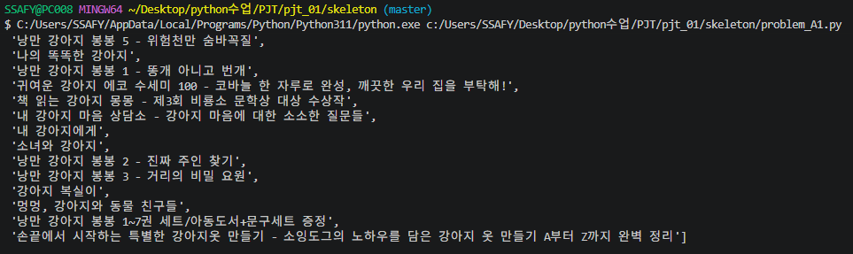

<br><br>

## 2️⃣ A2 · 도서 평균 가격 계산

각 도서의 판매가(`priceSales`)를 리스트에 모은 뒤 `sum() / len()`으로 평균을 구하고, `:.2f`로 소수 둘째 자리까지 출력했습니다.

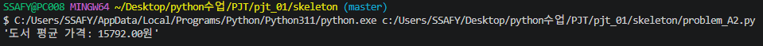

<br><br>

## 3️⃣ A3 · 평균 고객 리뷰 순위 계산

`customerReviewRank` 값을 모아 A2와 같은 방식으로 평균 리뷰 순위를 계산했습니다.

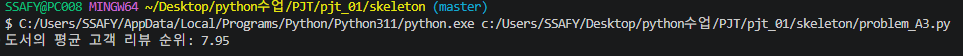

<br><br>

## 4️⃣ A4 · 도서별 작가 딕셔너리

`{제목: 작가}` 형태의 딕셔너리를 만들고 `.items()`로 순회하며 제목과 작가를 출력했습니다.

```python
for item in data['item']:
    book_authors[item['title']] = item['author']
```

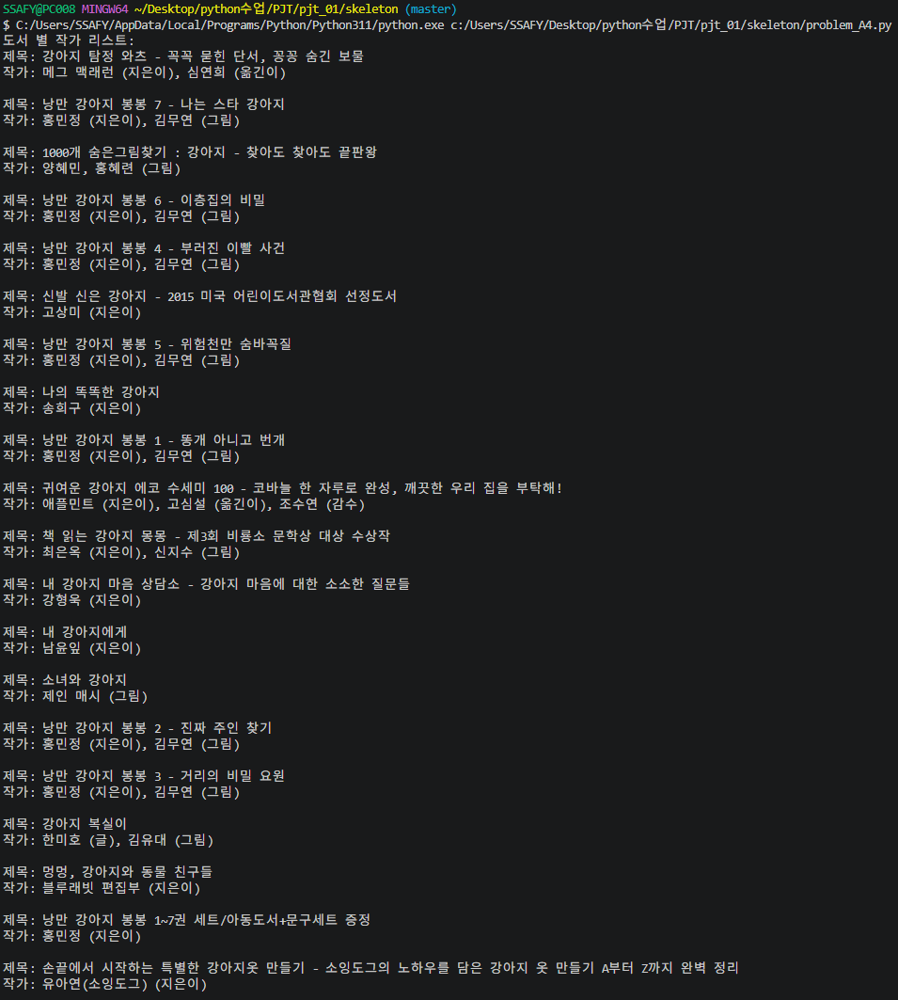

<br><br>

## 5️⃣ A5 · 정가 범위별 도서 분류

정가(`priceStandard`)를 기준으로 세 구간으로 나눠 제목을 분류했습니다.

| 구간 | 조건 |
| --- | --- |
| 💰 2만원 이상 | `priceStandard >= 20000` |
| 💵 1만원 이상 2만원 미만 | `priceStandard >= 10000` |
| 🪙 1만원 미만 | `priceStandard < 10000` |

- 📌 `setdefault(key, [])`로 키가 없을 때 빈 리스트를 만들고 바로 `append`

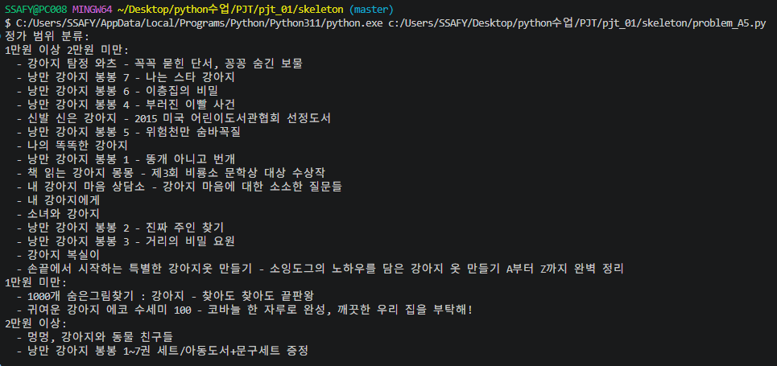

<br>

---

<br>

# 🅱️ 그룹 B

<br>

## 6️⃣ B1 · 어린이 도서가 아닌 책 필터링

`books_500.json`에서 `categoryName`에 **"어린이"** 가 포함되지 않은 도서만 골라 제목과 카테고리를 출력했습니다.

```python
if '어린이' not in book['categoryName']:
    non_children_books.append({book['title']: book['categoryName']})
```

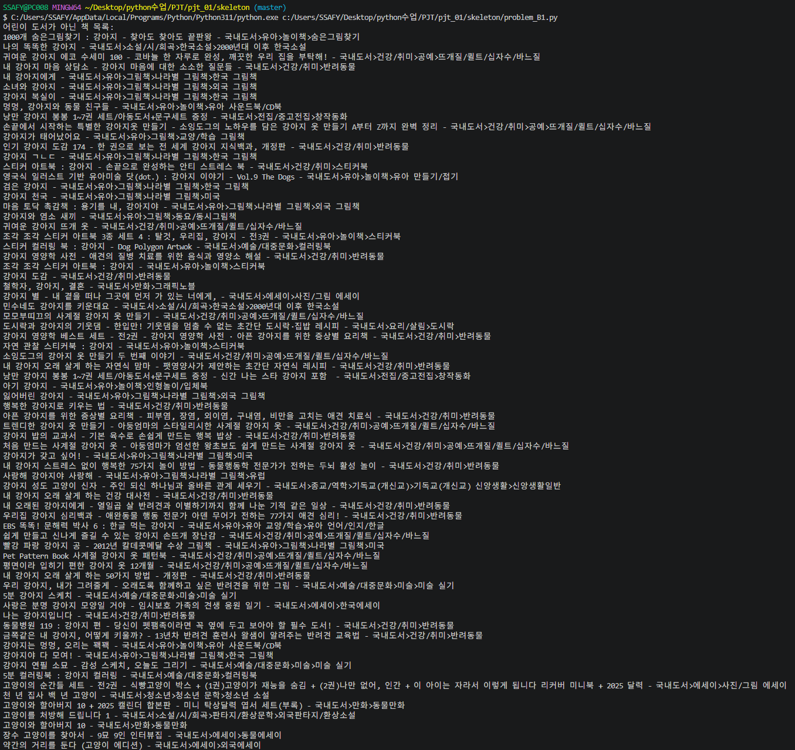

<br><br>

## 7️⃣ B2 · 출판사별 도서 수 집계

처음에는 `if key in dict` 분기로 직접 카운트했지만, `defaultdict(int)`로 바꿔 키가 없을 때의 처리를 없앴습니다.

```python
publisher_counts = defaultdict(int)
for book in books:
    publisher_counts[book['publisher']] += 1
```

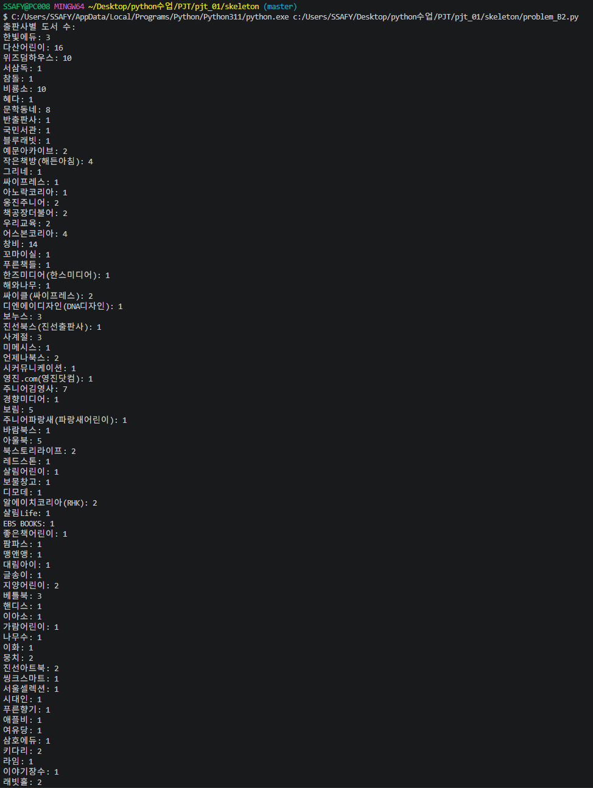

<br><br>

## 8️⃣ B3 · 카테고리별 도서 통계

`defaultdict(lambda: {'count': 0, 'sum': 0})`로 카테고리마다 도서 수와 가격 합계를 함께 모으고, 출력할 때 평균 가격을 계산했습니다.

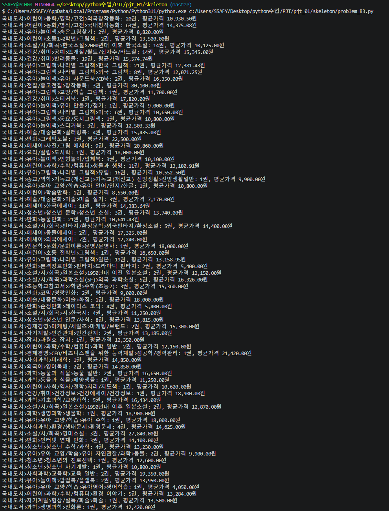

<br><br>

## 9️⃣ B4 · 최신 도서 10권 추출

`sorted()`의 `key`에 람다를 넘겨 출판일(`pubDate`) 기준 내림차순으로 정렬하고, 슬라이싱으로 상위 10권만 꺼냈습니다.

```python
latest_books = sorted(books, key=lambda book: book['pubDate'], reverse=True)[:10]
```

- 📌 `pubDate`가 `"YYYY-MM-DD"` 형태라 **문자열 그대로 정렬해도 날짜 순서와 같음**

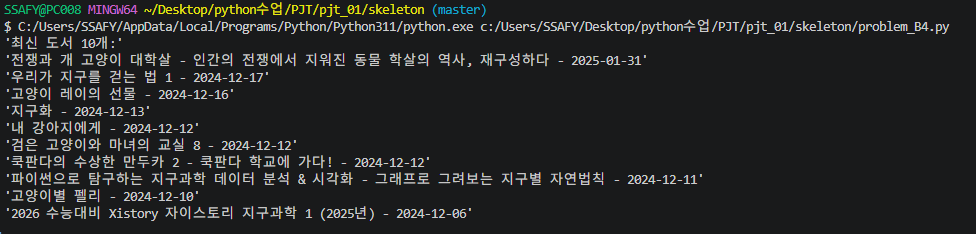

<br><br>

## 🔟 B5 · 할인율 상위 5권 추출

`(정가 - 판매가) / 정가 × 100`으로 할인율을 계산하는 함수를 만들어 각 도서에 `discount_rate`를 추가하고, 할인율 기준으로 정렬해 상위 5권을 출력했습니다.

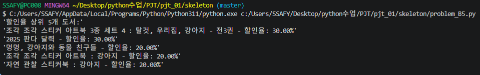

<br>

---

<br>

# 🅲 그룹 C

<br>

## 1️⃣1️⃣ C1 · 월별 평균 가격 계산

> 🤖 생성형 AI 활용

`books_2000.json`의 출판일을 `datetime`으로 바꿔 `YYYY-MM` 단위로 묶고, 월별 도서 수와 평균 가격을 계산했습니다.

- 📌 출판일이 `"20230501"`(8자리 숫자)과 `"2023-05-01"` 두 형태일 수 있어 둘 다 처리
- 📌 날짜나 가격이 비어 있거나 변환에 실패한 도서는 `continue`로 건너뜀
- 📌 결과는 월 순서대로 정렬해 출력

```python
month_key = dt.strftime('%Y-%m')
monthly_stats[month_key]['total_price'] += price_val
monthly_stats[month_key]['count'] += 1
```

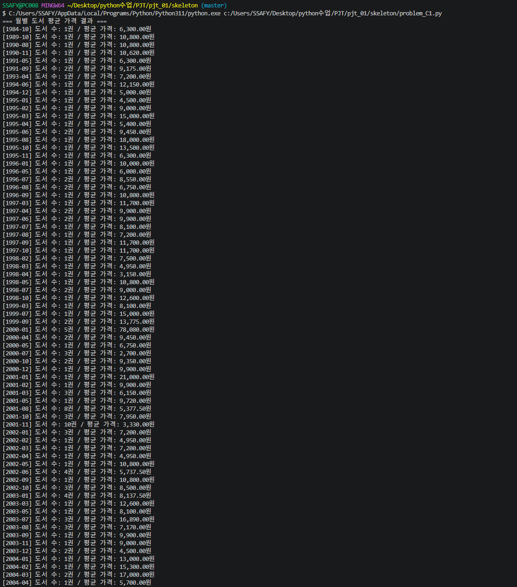

<br>

---

<br>

## 💡 배운 점

<br>

### 🔀 Fork & Pull Request 협업 흐름

원본 저장소를 **Fork**한 뒤 개인 작업공간에서 코드를 수정하고, **Pull Request**를 보내 코드 리뷰를 받는 흐름을 익혔습니다. 팀원이 작성한 코드를 하나로 모으고 병합(Merge)하는 과정도 직접 겪어봤습니다.

<br>

### 📁 `pathlib`으로 파일 다루기

`os.path`보다 직관적이고 객체 지향적인 `pathlib`으로 파일 경로를 만들고, 존재 여부 확인 · 읽기 · 쓰기를 간단하게 처리했습니다.

<br>

### 📄 JSON → 파이썬 데이터 구조

Key-Value 쌍으로 된 JSON을 `json.load()`로 딕셔너리와 리스트로 바꾸고, 필요한 필드만 꺼내 가공하는 `로드 → 필터링 → 집계 → 출력` 흐름을 열 개가 넘는 문제에 걸쳐 반복했습니다.

<br>

### 🧩 `defaultdict`와 `sorted()` + `lambda`

- `collections.defaultdict`: 키가 없을 때의 에러를 막고 빈도수 · 그룹핑을 깔끔하게 처리
- `sorted()` + `lambda`: 원하는 기준으로 정렬하고 슬라이싱으로 상위 N개 추출

<br>

---

<br>

## 🧗 어려웠던 점

| 영역 | 주요 어려움 |
| :--- | :--- |
| **JSON 데이터 처리** | JSON 구조를 처음 다루다 보니 파일 로드 과정과 구조 파악에 진입장벽이 있었습니다. |
| **Git & GitHub 협업** | 브랜치 분기, 과제 분담 및 병합 과정에서 명령어 사용이 익숙하지 않았습니다. |
| **에러 디버깅** | 트레이스백(Traceback) 메시지로 문제 위치와 원인을 파악하는 요령이 부족했습니다. |
| **AI 결과 검증** | AI 응답 중 현재 코드 상황에 맞는 **최적의 솔루션을 고르는** 기준을 잡기가 어려웠습니다. |

<br>

---

<br>

## 🤖 회고

- 🎯 **명세서 기반 프로그래밍** <br>
  요구사항 명세서에 맞춰 단계별로 코드를 완성하다 보니 프로그램 전체의 데이터 흐름을 한눈에 파악할 수 있었습니다.
- 📖 **실제 데이터 구조에 대한 이해** <br>
  JSON 파일을 직접 불러오고 처리하면서 실무에서 많이 쓰이는 데이터 포맷과 친숙해졌습니다.
- 🤖 **AI 활용에 대한 되돌아보기** <br>
  AI가 순식간에 많은 코드를 만들어 주었지만, 그 코드를 이해하기 위한 리뷰에 예상보다 많은 시간이 걸렸습니다. 코드를 복사하는 것이 아니라 **"동작 원리를 내 것으로 만드는 과정"** 이 무엇보다 중요하다는 점을 깨달았습니다.

<br>

---

<br>

## ⚠️ 실행 시 참고사항

- 📂 데이터 경로가 상대 경로(`./data/...`)이므로 **`skeleton/` 폴더에서 실행**해야 합니다.
- 🗃️ A그룹은 `books_20.json`(딕셔너리, `item` 키 아래 목록), B그룹은 `books_500.json`(리스트)을 사용해 **최상위 구조가 다릅니다**.
- ⬜ C2 · C3는 아직 구현하지 않았습니다.

<br>
