<div align="center">

# 📖 03-pjt

### Bootstrap으로 만드는 🧵 ThRead 반응형 웹 페이지

AI 기반 도서 분석 및 창작 지원 통합 솔루션 서비스 **ThRead**의 메인 페이지를 <br>
Bootstrap으로 구성하고, Django 백엔드까지 확장해보는 프로젝트

<br>


`YYYY.MM.DD`

<br>

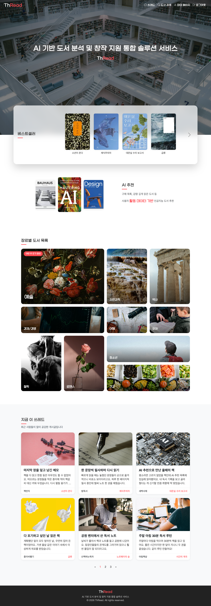

</div>

<br>

## 🗂️ 진행 범위

| 구분 | 요구사항 | 상태 |
| :---: | --- | :---: |
| **필수** | F301 · F302 · F303 · F304 · F305 · F306 · F307 · F308 | ✅ 완료 |
| **심화** | 1단계 · F309 · F310 · F311 | ✅ 완료 |
| **확장** | Django 백엔드 (검색 · 회원 · 쓰레드 · 마이페이지 · AI 추천) | ✅ 완료 |

<br>

## 🎯 목표

- HTML을 활용한 웹 페이지 마크업 작업을 이해한다.
- CSS 라이브러리를 이해하고 활용한다.
- Bootstrap 컴포넌트 및 Grid system을 활용하여 반응형 레이아웃을 구성한다.
- 생성형 AI를 활용하여 디자인을 생성하고 적용한다.

<br>

## 🧰 사용 기술

| 구분 | 내용 |
| --- | --- |
| 🎨 마크업 · 스타일 | HTML · CSS |
| 📦 라이브러리 | Bootstrap 5.3.3 · Bootstrap Icons 1.11.3 |
| 🛠️ 도구 | Visual Studio Code · Google Chrome |
| 🐍 확장 (백엔드) | Python 3.14 · Django 5.2 LTS · SQLite |
| 🌐 외부 API | 알라딘 Open API · Claude API (SSAFY GMS) |

<br>

## 📁 프로젝트 구조

```
03-pjt/
├── 📂 live_code/                        # 수업 실습 코드
└── 📂 skeleton/
    ├── 📄 01-navbar.html                # F301·F302 Navbar & Hero
    ├── 📄 02-bestseller.html            # F303 베스트셀러
    ├── 📄 03-ai_recommendation.html     # F304 AI 추천
    ├── 📄 04-genre_list.html            # F305 장르별 도서 목록 (Flexbox)
    ├── 📄 04-genre_list_grid.html       # [심화] F310 장르별 도서 목록 (CSS Grid 벤토)
    ├── 📄 05-popular_thread.html        # F306 인기 쓰레드
    ├── 📄 06-main.html                  # F307 결합 + F308 Modal + [심화] 1단계·F309·F310
    ├── 📄 07-book_detail.html           # [심화] F311 도서 상세 페이지
    ├── 📂 assets/                       # 이미지, 폰트
    ├── 📂 screenshots/                  # 실행 화면 캡처 (backend/ : Django 화면)
    └── 📂 backend/                      # [확장] Django 백엔드 (backend/README.md 참고)
```

<br>

## 🚀 실행 방법

**1️⃣ 정적 페이지**

`skeleton/06-main.html`을 브라우저로 엽니다. 각 섹션은 `01` ~ `05` 파일로 따로 확인할 수 있습니다.

메인 페이지에서 "채식주의자" 표지(베스트셀러) 또는 도서명(인기 쓰레드)을 누르면 상세 페이지(`07-book_detail.html`)로 이동합니다.

**2️⃣ Django 버전**

`skeleton/backend/`에서 실행합니다. 설치 · 환경 변수 · 명령어는 [backend/README.md](skeleton/backend/README.md)에 있습니다.

```bash
cd skeleton/backend
python manage.py runserver
```

<br>

## 📱 반응형 기준

| 구간 | 폭 | 주요 변화 |
| --- | --- | --- |
| 📱 모바일 | 576px 미만 | Navbar 토글 메뉴, 장르·쓰레드 1열 |
| 📟 태블릿 | 576px ~ 991px | 베스트셀러 2×2, 장르·쓰레드 2열, AI 추천 위아래 배치 |
| 🖥️ 데스크톱 | 992px 이상 | 베스트셀러 4권 한 줄, 장르 4열, 쓰레드 3열, AI 추천 7:5 |

<br>

## 🎨 공통 작업

**🔤 폰트가 적용되지 않던 문제 수정**

스켈레톤의 `@font-face`가 `format("ttf")`로 선언되어 있었는데, 브라우저가 인식하는 값은 `format("truetype")`입니다. 잘못된 format 힌트가 있으면 브라우저가 해당 폰트를 아예 내려받지 않기 때문에, 모든 파일에서 `truetype`으로 수정했습니다.

**🖌️ 공통 디자인 값**

| 항목 | 값 |
| --- | --- |
| 포인트 색상 | `#fe4a51` |
| 로고 "ThRead" | "Th" `#fff` / "Read" `#fe4a51`, `GmarketSansTTFMedium` |
| 메뉴·강조 텍스트 | `SBAggro_L` (SBAggroOTF_L.ttf) |
| 섹션 폭 | 80%, 가운데 정렬 (베스트셀러 제외) |

<br>

---

<br>

# ✅ 필수 과제

<br>

## 1️⃣ F301·F302 · Navbar & Hero

> 🎯 `F301` `F302` · `01-navbar.html`

| 데스크톱 | 모바일 | 모바일 (메뉴 펼침) |
| --- | --- | --- |
| 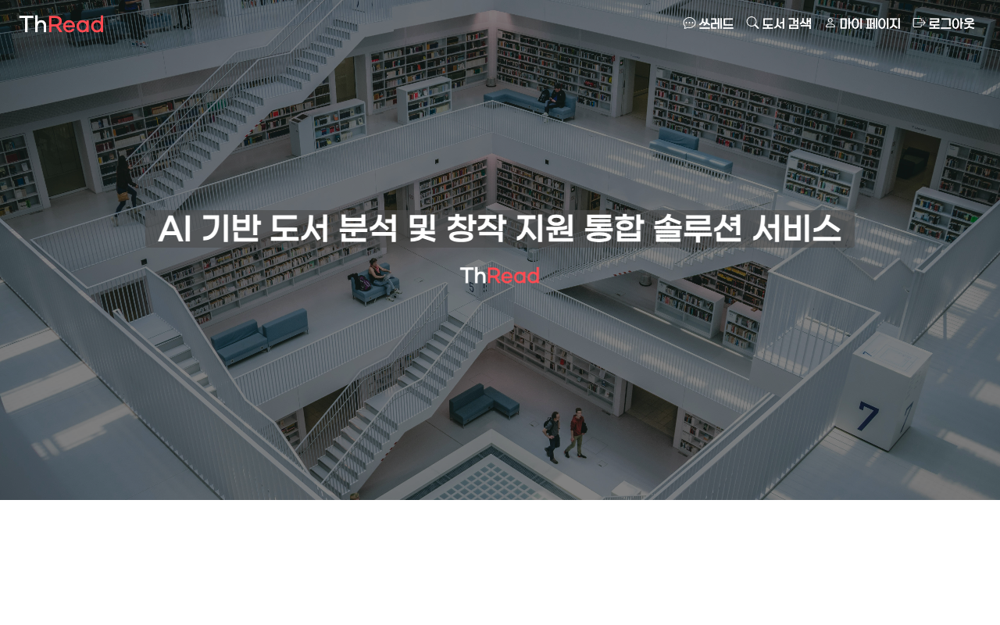 | 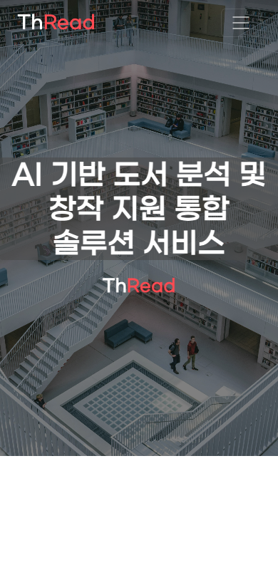 | 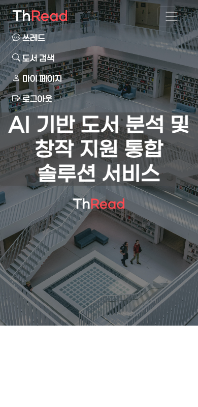 |

**🛠️ 구현 내용**

- `navbar-expand-sm`으로 576px 미만에서 토글 버튼 메뉴로 전환
- 배경 클래스 없이 투명하게 두고, `position-absolute top-0` + `z-index: 1030`으로 Hero 위에 고정
- 메뉴 항목에 Bootstrap Icons(`bi-chat-dots`, `bi-search`, `bi-person`, `bi-box-arrow-right`) 추가
- 메뉴 텍스트는 흰색, hover 시 `#fe4a51`
- Hero 제목에 `<br class="d-sm-none">`을 넣어 576px 미만에서만 "AI 기반 도서 분석 및" 뒤 줄바꿈

**📌 학습 포인트**

- `navbar-expand-{breakpoint}`는 해당 breakpoint **이상**에서 메뉴를 펼친다. `sm`(576px)이 명세의 기준과 정확히 일치해서 미디어 쿼리를 따로 쓸 필요가 없었다.
- `d-sm-none`처럼 display 유틸리티를 `<br>`에 적용하면 특정 폭에서만 줄바꿈을 줄 수 있다.
- Bootstrap의 `.nav-link` 색상을 덮어쓰려면 `.main-nav .nav-link`처럼 선택자를 한 단계 더 구체적으로 써야 한다.

**🧗 어려웠던 점**

- 모바일에서 제목이 "솔루 / 션"처럼 단어 중간에서 끊겼다. 한글은 기본적으로 글자 단위로 줄바꿈되기 때문이었고, `word-break: keep-all`을 주어 단어 단위로 줄바꿈되게 했다.

<br><br>

## 2️⃣ F303 · 베스트셀러

> 🎯 `F303` · `02-bestseller.html`

| 데스크톱 | 모바일 |
| --- | --- |
| 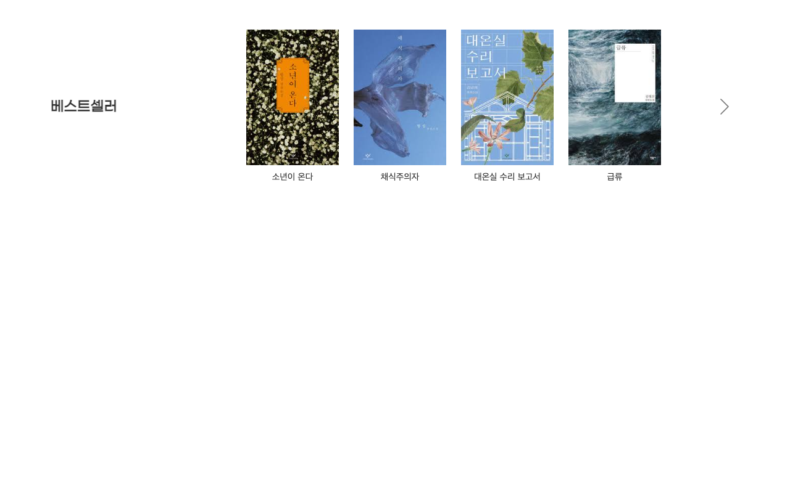 | 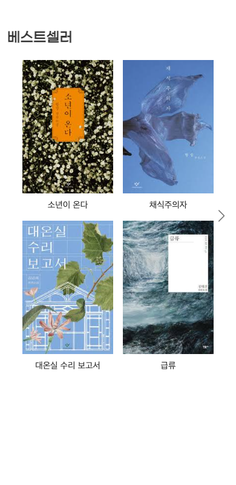 |

**🛠️ 구현 내용**

- Bootstrap Carousel로 12권을 4권씩 3개 슬라이드로 구성
- `data-bs-ride="carousel"`로 자동 전환, `carousel-control-prev`는 넣지 않아 Next 버튼만 출력
- 왼쪽 제목(`col-lg-2`), 오른쪽 캐러셀(`col-lg-10`)
- 표지 이미지 `150×220px` 고정 + `object-fit: cover`, 표지 아래 책 제목(`text-truncate`)
- 992px 미만에서는 2×2 배치

**📌 학습 포인트**

- 원본 표지들의 비율이 조금씩 달라서 `width`/`height`만 고정하면 찌그러진다. `object-fit: cover`로 비율을 유지한 채 칸을 채울 수 있다.
- 흰 배경에서 기본 흰색 화살표가 보이지 않을 때, Bootstrap 5.3에서는 `data-bs-theme="dark"`로 어두운 컨트롤을 쓸 수 있다.

**🧗 어려웠던 점**

- 기본 `carousel-control-next`는 캐러셀 폭의 15%를 차지해서 마지막 책 위에 겹쳤다. 버튼 폭을 `3rem`으로 줄이고 `carousel-inner`에 좌우 `padding: 0 3rem`을 주어 책과 겹치지 않게 했다.
- 책 4권 + 간격은 약 672px이라 태블릿 폭에서는 한 줄에 들어가지 않았다. `max-width`를 "4권 폭"과 "2권 폭"으로 바꾸는 방식으로 992px 미만에서 2×2가 되게 했다.
- 390px 폰에서는 그래도 1열로 떨어졌다. 버튼 자리로 남겨 둔 좌우 여백 때문에 2권(316px)이 들어갈 공간이 부족했다. 576px 미만에서는 여백을 없애고 간격과 버튼 크기를 줄여 해결했다.

<br><br>

## 3️⃣ F304 · AI 추천

> 🎯 `F304` · `03-ai_recommendation.html`

| 데스크톱 | 모바일 |
| --- | --- |
| 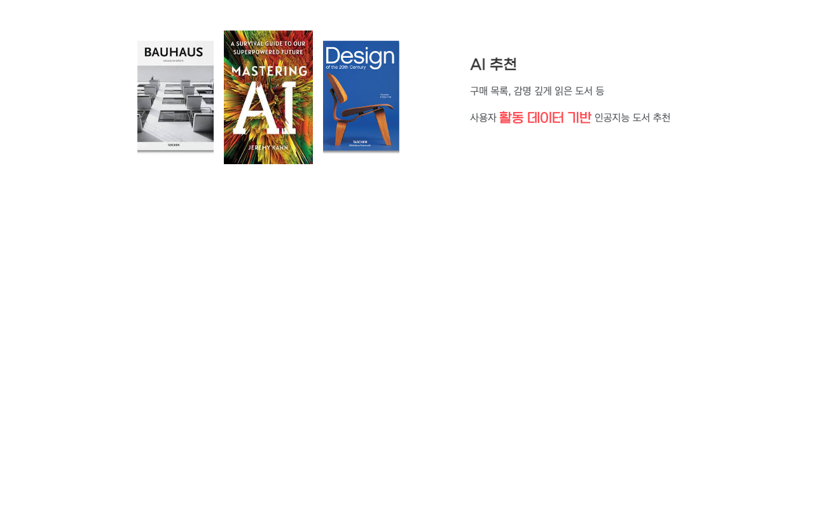 | 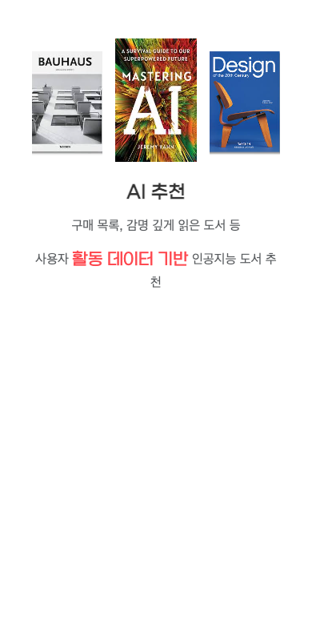 |

**🛠️ 구현 내용**

- 섹션 폭 80%, 가운데 정렬
- `row align-items-center` + `col-lg-7` / `col-lg-5`로 7:5 비율, 수직 가운데 정렬
- "활동 데이터 기반"을 `<span class="highlight">`로 감싸 `#fe4a51`, `SBAggroOTF_L`, `1.3rem` 적용
- 좁은 화면에서는 이미지 위·텍스트 아래로 쌓이고 텍스트는 가운데 정렬(`text-center text-lg-start`)

**📌 학습 포인트**

- `align-items-center`를 row에 주면 서로 높이가 다른 열을 수직 가운데 정렬할 수 있다.
- `text-center text-lg-start`처럼 반응형 유틸리티를 겹쳐 쓰면 breakpoint마다 정렬을 바꿀 수 있다.

**🧗 어려웠던 점**

- 스켈레톤은 이미지 크기를 `style="width:140px; height:210px"`처럼 인라인으로 지정하고 있었다. 인라인 스타일은 미디어 쿼리보다 우선해서 모바일에서 크기를 줄일 수 없었다. 크기를 `.ai-book` / `.ai-book-main` 클래스로 옮기고, 576px 미만에서는 `width: 28%`, `aspect-ratio: 2 / 3`으로 비율을 유지하며 줄였다.
- 768px(`md`)에서 7:5로 나누면 이미지 영역이 약 406px로 책 3권이 넘쳤다. 그래서 7:5 분할 기준을 `lg`(992px)로 정했다.

<br><br>

## 4️⃣ F305 · 장르별 도서 목록

> 🎯 `F305` · `04-genre_list.html`

| 데스크톱 | 모바일 |
| --- | --- |
| 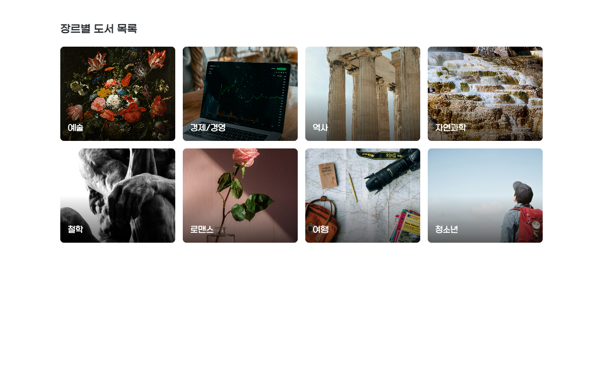 | 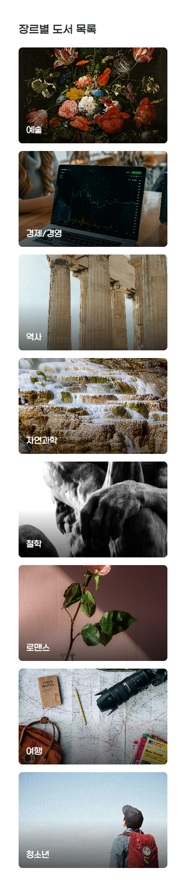 |

**🛠️ 구현 내용**

- 섹션 폭 80%, 가운데 정렬
- `display: flex; flex-wrap: wrap; gap: 1rem` 컨테이너에 장르 아이템 8개 배치
- 아이템 폭 `calc((100% - 1rem * 3) / 4)`로 4열, 높이 `200px` 고정
- 이미지는 `width/height: 100%` + `object-fit: cover`로 부모 크기를 채움
- 장르명은 `position: absolute`로 왼쪽 아래에 겹쳐 출력, 하단 그라데이션(`::after`)으로 가독성 확보
- 태블릿 2열, 모바일 1열(폭 100%)

**📌 학습 포인트**

- `gap`을 쓸 때는 `flex-basis`에서 간격만큼 빼야 정확히 N열이 된다.
- 부모를 `position: relative`, 자식을 `absolute`로 두는 것이 오버레이의 기본 패턴이다.

**🧗 어려웠던 점**

- 제공된 이미지가 10장이라 4열이면 마지막 줄이 2칸만 남았다. 유아·건강을 제외한 8장을 사용해 4×2로 맞췄다. 남은 2장은 심화 과제(F310)에서 활용했다.
- 역사·여행처럼 밝은 사진 위에서는 흰 장르명이 잘 보이지 않아 하단에 옅은 검은 그라데이션을 깔았다.

<br><br>

## 5️⃣ F306 · 인기 쓰레드

> 🎯 `F306` · `05-popular_thread.html`

| 데스크톱 | 모바일 |
| --- | --- |
| 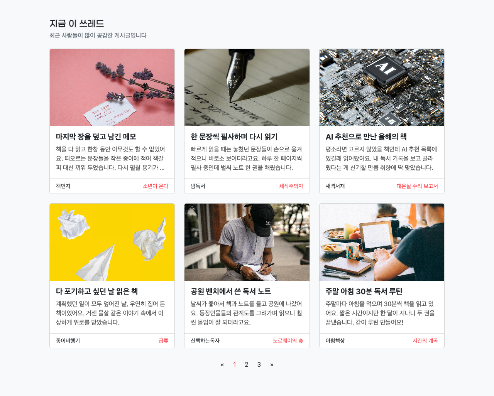 | 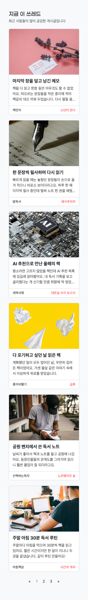 |

**🛠️ 구현 내용**

- 스켈레톤의 `.container`를 `.thread-list`로 바꿔 섹션 폭 80% 적용
- `col-12 col-sm-6 col-lg-4`로 3열 / 태블릿 2열 / 모바일 1열
- `card h-100` + `card-img-top`(높이 200px 고정) + `card-body`(제목, 본문) + `card-footer`(작성자, 도서명 `#fe4a51`)
- 본문은 `-webkit-line-clamp: 3`으로 3줄 말줄임
- Pagination은 테두리 제거, 배경 투명, 활성 페이지 `#fe4a51`

**📌 학습 포인트**

- `h-100`으로 같은 줄 카드의 높이를 맞추면, `card-body`의 `flex: 1 1 auto` 덕분에 본문 길이와 상관없이 footer가 항상 카드 맨 아래에 붙는다.
- `.thread .pagination .page-item.active .page-link`처럼 클래스를 더 붙여 명시도를 높이면 `!important` 없이 Bootstrap 기본 스타일을 덮어쓸 수 있다.

> ⚠️ Bootstrap은 활성 페이지(`.active > .page-link`)에 파란 배경을 따로 주기 때문에, 글자색만 바꾸면 파란 배경이 남습니다. 활성 페이지의 배경까지 `transparent`로 지정하고, 클릭 시 생기는 focus 테두리(`box-shadow`)도 함께 제거했습니다.

<br><br>

## 6️⃣ F307 · 메인 페이지 결합

> 🎯 `F307` · `06-main.html`

> 💡 아래 캡처는 심화 과제(1단계, F309, F310)까지 적용된 최종 화면입니다. 각 심화 내용은 [심화 과제](#-심화-과제)에 정리했습니다.

| 데스크톱 | 모바일 |
| --- | --- |
|  | 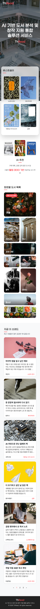 |

**🛠️ 구현 내용**

- Navbar & Hero → 베스트셀러 → AI 추천 → 장르별 도서 목록 → 인기 쓰레드 → 푸터 순서로 결합
- 각 파일의 CSS를 하나의 `<style>`에 섹션별 주석으로 구분해 합침

**🧹 합치면서 정리한 것**

| 문제 | 정리 방법 |
| --- | --- |
| 폰트 이름이 `SBAggro_L`(01/02/04/05)과 `SBAggroOTF_L`(03)로 달랐음 | `SBAggro_L` 하나로 통일 |
| `.section-title`의 margin이 파일마다 달랐음 | 공통 스타일은 한 번만 선언하고, 간격은 `mb-*` 유틸리티로 지정 |
| `body` 스타일이 일부 파일에만 있었음 | 한 번만 선언해 글자색·폰트 통일 |
| 섹션별 세로 여백이 제각각이었음 | 모든 섹션 `py-5`로 통일 |

**✨ UX를 위해 추가한 것**

- Navbar "쓰레드" 링크를 인기 쓰레드 섹션(`#thread`)으로 연결
- `scroll-behavior: smooth`로 부드러운 스크롤
- 로고와 서비스명을 담은 푸터

**📌 학습 포인트**

- 여러 파일을 합칠 때는 클래스 이름 충돌과 같은 이름의 다른 스타일을 먼저 확인해야 한다.

<br><br>

## 7️⃣ F308 · 로그아웃 확인 Modal

> 🎯 `F308` · `06-main.html`

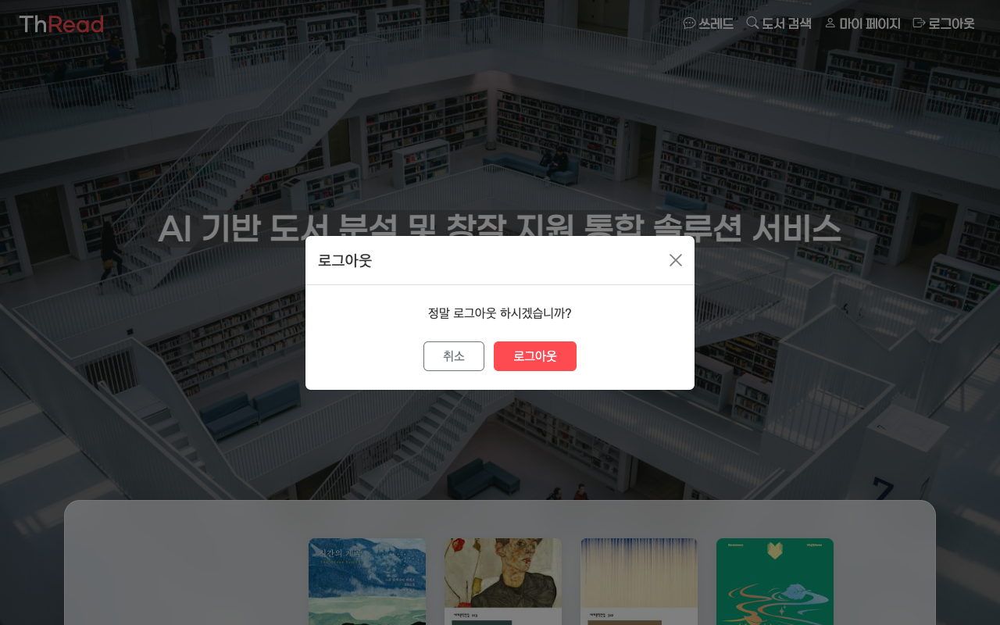

**🛠️ 구현 내용**

- Navbar 로그아웃 링크에 `data-bs-toggle="modal" data-bs-target="#logoutModal"`
- `modal-dialog-centered`로 화면 가운데에 표시
- 헤더 오른쪽 위 `btn-close`(X), 본문에 확인 메시지와 취소·로그아웃 버튼을 가운데 정렬
- X, 취소, 로그아웃 버튼은 `data-bs-dismiss="modal"`로 닫힘
- 바깥 영역 클릭은 Bootstrap 기본 동작으로 닫힘(`data-bs-backdrop="static"`을 쓰지 않음)

**📌 학습 포인트**

- Bootstrap Modal은 JavaScript를 직접 쓰지 않아도 `data-bs-*` 속성만으로 열고 닫을 수 있다.
- 바깥 클릭으로 닫히는 것은 기본 동작이고, 오히려 막으려면 `data-bs-backdrop="static"`이 필요하다.

<br>

---

<br>

## 📝 명세 외에 추가·결정한 사항

| 항목 | 결정 | 이유 |
| --- | --- | --- |
| 태블릿 폭(576~991px) | 베스트셀러 2×2, 장르·쓰레드 2열 | 명세는 데스크톱·모바일만 정의. 중간 폭에서 4열·3열이 너무 좁아짐 |
| 장르 이미지 | 10장 중 8장 사용 (유아·건강 제외) | 4열 배치에서 마지막 줄이 비지 않도록 |
| 장르 아이템 "고정 크기" | 높이 200px 고정, 폭은 4등분 | 폭까지 px로 고정하면 80% 폭 안에 4열이 맞지 않음 |
| 베스트셀러 섹션 폭 | Bootstrap `.container` 유지 | 80%로 바꾸면 992~1199px에서 4권이 한 줄에 들어가지 않음 |
| 쓰레드 콘텐츠 | 썸네일 분위기에 맞춘 더미 글, 베스트셀러 도서와 연결 | 제공된 텍스트 데이터가 없음 |
| Navbar 아이콘 | Bootstrap Icons 사용 | 명세의 메뉴 텍스트 앞 공백이 아이콘 자리로 보임. F311에서도 필요 |

<br>

---

<br>

# 🚀 심화 과제

필수 과제(01 ~ 05)는 그대로 두고, **모던한 스타일의 동적 디자인**을 목표로 `06-main.html`과 새 파일에 적용했습니다. <br>
효과를 많이 넣기보다 몇 가지 규칙(디자인 토큰, 등장 애니메이션, hover, 유리 카드)을 사이트 전체에 일관되게 쓰는 데 집중했습니다.

<br>

## 8️⃣ 1단계 · 디자인 토큰 · 스크롤 등장 · hover

> 🎯 `06-main.html`

**🛠️ 구현 내용**

- 🎨 **디자인 토큰**: 색, 모서리 반경, 그림자, 애니메이션 속도, 섹션 여백을 `:root`의 CSS 변수로 정리하고, 하드코딩된 `#fe4a51`을 모두 `var(--brand)`로 교체
- 📏 **섹션 여백·제목**: 섹션 여백을 데스크톱 5rem / 모바일 3rem으로 늘리고, 모든 섹션 제목 아래에 `::after`로 빨간 강조선 추가
- 🌅 **Hero**: 배경 사진이 20초 동안 천천히 확대되는 켄 번즈 효과, 제목과 "ThRead"가 차례로 떠오르는 등장 애니메이션 (`@keyframes`)
- 📜 **스크롤 등장**: 화면에 들어오는 요소가 아래에서 떠오르며 나타남. 장르 타일과 쓰레드 카드는 같은 줄 안에서 80ms씩 늦게 등장 (stagger)
- 🖱️ **hover**: 책 표지 떠오르기, 장르 타일 이미지 확대 + 장르명 상승, 쓰레드 카드 떠오르기 + 이미지 확대, Navbar 메뉴 밑줄이 자라나는 효과
- 🃏 **쓰레드 카드**: 테두리를 없애고 그림자 카드로 변경
- ♿ **접근성**: OS의 "동작 줄이기"(`prefers-reduced-motion`)를 켠 사용자에게는 모든 움직임 끄기

**📌 학습 포인트**

- `IntersectionObserver`로 요소가 화면에 들어오는 순간을 감지할 수 있다. 등장한 요소는 `unobserve`해서 한 번만 재생되게 했다.
- stagger는 요소마다 `style="--i: 0"`처럼 순번을 주고 `transition-delay: calc(var(--i) * 80ms)`로 계산하면 JS 없이 CSS만으로 만들 수 있다.
- 애니메이션은 `transform`과 `opacity`만 움직여야 레이아웃이 흔들리지 않고 부드럽다.
- hover 효과를 `@media (hover: hover)` 안에 두면, 폰에서 탭한 뒤 hover 상태가 남는 문제를 막을 수 있다.

**🧗 어려웠던 점**

- 처음에는 `html`에 `js` 클래스를 붙이는 코드를 `<body>` 끝에 두었더니, 이미 보이던 요소가 잠깐 보였다가 사라진 뒤 다시 나타나는 깜빡임이 생겼다. 이 한 줄을 `<head>`로 옮겨서 첫 화면을 그리기 전에 숨김 상태가 적용되도록 했다.
- JS가 꺼져 있으면 숨겨진 요소가 영영 안 보일 수 있어서, `.js .reveal`처럼 `js` 클래스가 있을 때만 숨기도록 했다.

> ⚠️ 캐러셀은 `overflow: hidden`이라서 표지가 hover로 떠오를 때 위쪽 그림자가 잘립니다. `carousel-inner`에 위아래 여백을 미리 주었습니다.

<br><br>

## 9️⃣ F309 · 베스트셀러 글래스모피즘 오버랩

> 🎯 `F309` · `06-main.html`


**🛠️ 구현 내용**

- 베스트셀러를 반투명 흰 유리 카드(`backdrop-filter: blur(18px)`)로 감싸고, Hero 위에 **정확히 절반**이 걸치도록 재배치
- 카드 높이의 절반만큼 음수 `margin-top`을 주어 끌어올리고, 아래 AI 추천 섹션도 함께 올라오도록 위치 재조정
- Hero는 카드에 가려지는 만큼 늘려서(`min-height: calc(80vh + var(--overlap))`), 가려지지 않는 영역이 항상 80vh로 유지되게 함
- 블러를 지원하지 않는 브라우저는 `@supports not (...)`로 거의 불투명한 흰 카드를 보여줌

**📌 학습 포인트**

- `transform`으로 올리면 원래 자리가 빈 채로 남지만, 음수 `margin`으로 올리면 뒤따르는 요소도 함께 올라온다. "AI 추천 위치 재조정"이 자연스럽게 해결됐다.
- 카드 높이는 화면 폭마다 다르기 때문에(데스크톱 356px, 모바일 661px) 고정값으로는 "정확히 절반"을 맞출 수 없다. `ResizeObserver`로 카드 높이를 재서 CSS 변수 `--overlap`에 넣고, CSS에서 이 변수를 쓰도록 했다.
- `backdrop-filter`는 Safari를 위해 `-webkit-` 접두사를 함께 써야 한다.

**🧗 어려웠던 점**

- 유리 카드의 안쪽 여백 때문에 992 ~ 1199px 폭에서 왼쪽 제목 + 책 4권이 한 줄에 들어가지 않았다. 메인 페이지에서는 1200px 이상(`col-xl-*`)에서만 제목을 왼쪽에 두고, 그보다 좁으면 제목을 캐러셀 위로 올렸다. (`02-bestseller.html`은 그대로)
- 카드가 Hero 아래쪽을 덮으면서, 특히 모바일(카드가 2×2라 큼)에서 Hero 제목과 겹칠 위험이 있었다. Hero 높이와 아래 여백을 `--overlap`만큼 늘려 해결했다.

| 폭 | 카드 높이 | Hero에 걸친 높이 | 표지 배치 |
| --- | --- | --- | --- |
| 1280px | 356px | 178px | 한 줄 4권, 제목 왼쪽 |
| 1100px | 411px | 206px | 한 줄 4권, 제목 위 |
| 800px | 685px | 343px | 2×2 |
| 390px | 661px | 331px | 2×2 |

<br><br>

## 🔟 F310 · 장르 목록 CSS Grid 벤토

> 🎯 `F310` · `04-genre_list_grid.html` · `06-main.html`

| 데스크톱 | 모바일 |
| --- | --- |
| 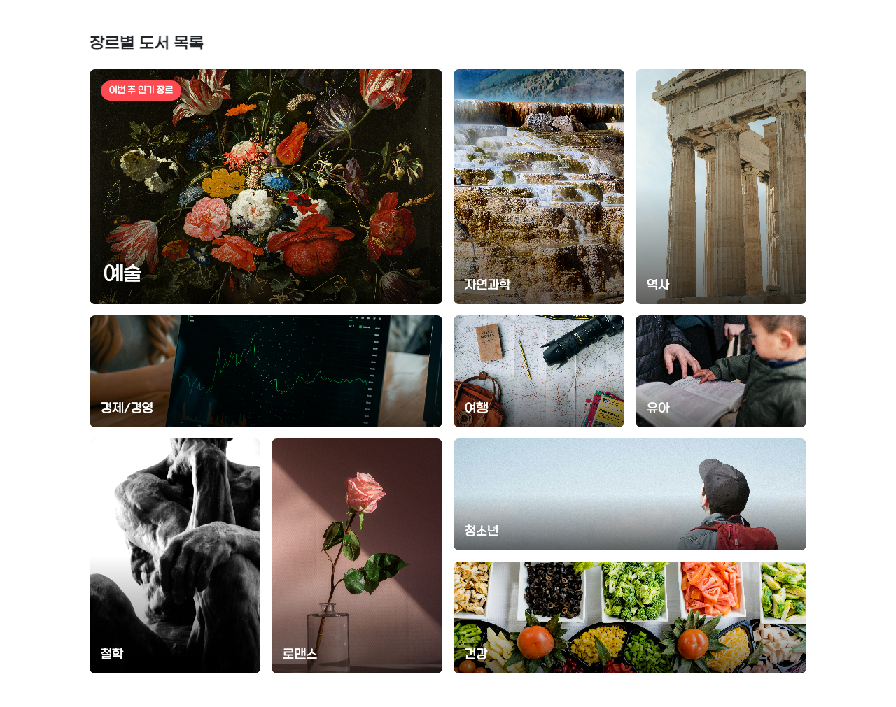 | 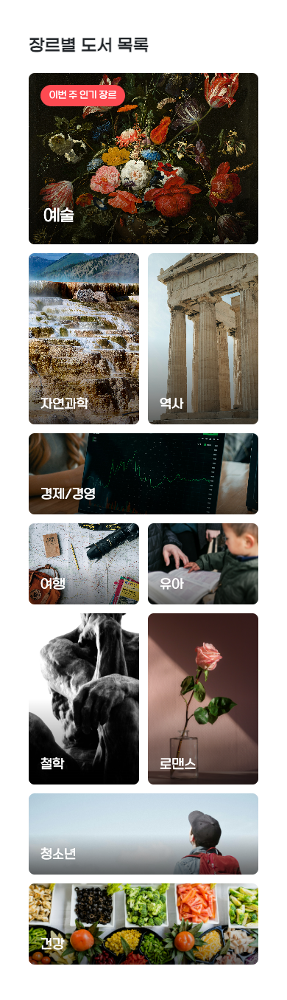 |

**🛠️ 구현 내용**

- F305(Flexbox) 결과물을 지키기 위해 `04-genre_list.html`은 그대로 두고, `04-genre_list_grid.html`을 새로 만들어 확장
- 장르 이미지 10장을 모두 사용한 **벤토 그리드**: 데스크톱 4열 × 5줄, 태블릿·모바일 2열
- 대표 타일(예술)은 2×2 크기에 "이번 주 인기 장르" 배지와 큰 장르명으로 강조
- 메인 페이지의 장르 섹션도 Flexbox CSS를 Grid CSS로 **교체**

```css
.genre-grid {
  display: grid;
  grid-template-columns: repeat(4, 1fr);
  grid-auto-rows: 160px;
  gap: 1rem;
  grid-template-areas:
    "art art sci his"
    "art art sci his"
    "eco eco tra bab"
    "phi rom you you"
    "phi rom hea hea";
}
.genre-art { grid-area: art; }
```

**📌 학습 포인트**

- `grid-template-areas`를 쓰면 배치를 문자열로 그림처럼 표현할 수 있어서, 코드만 봐도 레이아웃이 보인다. 반응형에서는 이 문자열만 바꾸면 된다.
- `grid-auto-rows`로 한 줄 높이를 정하면, 2줄을 차지하는 타일은 `줄 높이 × 2 + gap`이 된다.
- 세로 사진(예술, 역사, 자연과학, 철학, 로맨스)은 세로로 긴 칸에, 가로 사진(경제, 청소년, 건강 등)은 가로로 넓은 칸에 배치해서 `object-fit: cover`로 잘리는 부분을 최소화했다.

**🧗 어려웠던 점**

- 명세는 "기존 04-genre_list.html을 확장"하라고 했지만, 직접 고치면 필수 과제 F305 결과물이 사라진다. 그래서 새 파일로 분리했다.
- 메인 페이지에서 Grid 규칙을 기존 Flexbox 규칙 위에 덧씌우면 `flex-basis` 같은 쓸모없는 규칙이 남아 헷갈렸다. 장르 CSS 블록을 통째로 교체했다.

<br><br>

## 1️⃣1️⃣ F311 · 「채식주의자」 도서 상세 페이지

> 🎯 `F311` · `07-book_detail.html`

| 데스크톱 (대여 가능 도서관 탭) | 데스크톱 (쓰레드 탭 + 담기 누른 상태) |
| --- | --- |
| 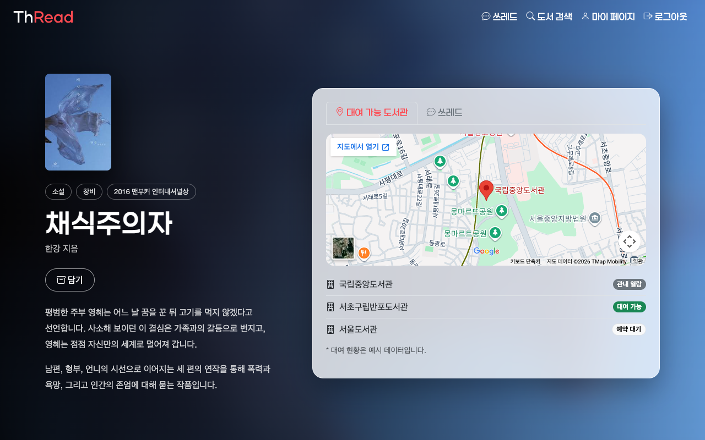 | 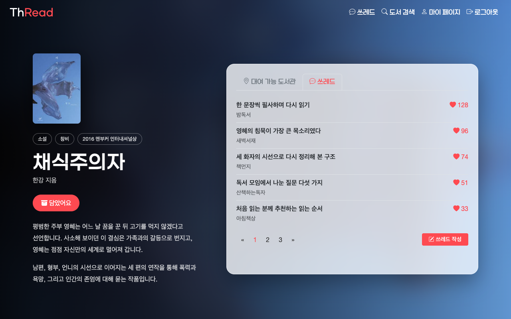 |

**📱 모바일**

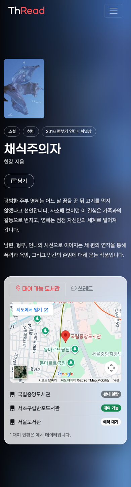

**🛠️ 구현 내용**

- 메인 페이지의 "채식주의자" 표지(베스트셀러)와 도서명(인기 쓰레드)에서 링크로 이동
- 기존 Navbar 유지 (로고 → 메인, 쓰레드 → 메인의 쓰레드 섹션, 로그아웃 → Modal)
- `min-height: 100vh` Hero에 도서 표지 배경 + 왼쪽은 검정, 오른쪽은 투명에 가까운 그라데이션 오버레이
- **왼쪽 (작가 및 도서 소개)**: 표지 썸네일, 메타 정보 칩, 제목 "채식주의자", `bi-archive` 아이콘이 들어간 "담기" 버튼, 소개글
- **오른쪽 (세부 정보 탭)**: F309와 같은 유리 카드 안에 `nav-tabs` 탭 2개
  - 🗺️ 대여 가능 도서관: Google Map `iframe`(국립중앙도서관 중심) + 도서관 목록과 대여 상태 배지
  - 🧵 쓰레드: 제목·작성자·좋아요 수 목록, pagination, "쓰레드 작성" 버튼
- "담기" 버튼 토글: 아이콘 `bi-archive` → `bi-archive-fill`, 문구 "담기" → "담았어요", 빨간 채움 버튼, `aria-pressed` 갱신
- 진입 시 표지 → 칩 → 제목 → 버튼 → 소개글 → 유리 카드 순서로 등장

**📌 학습 포인트**

- Bootstrap 탭은 `data-bs-toggle="tab"`과 `data-bs-target`만으로 동작하고, `tab-pane`에 `fade` 클래스를 주면 전환이 부드러워진다.
- Google Map은 `https://www.google.com/maps?q=장소&output=embed` 형식으로 API 키 없이 `iframe`에 넣을 수 있다.
- 토글 버튼은 모양만 바꾸지 말고 `aria-pressed`도 함께 바꿔야 스크린 리더가 상태를 읽을 수 있다.

**🧗 어려웠던 점**

- 명세의 배경 이미지 `assets/book_detail/book_cover.jpg`가 제공된 assets에 없었다. 베스트셀러 표지(182×276)를 대신 썼는데, 작은 이미지를 화면 전체로 키우면 깨져 보여서 `filter: blur(28px)`로 크게 흐리게 처리했다. 블러를 주면 가장자리가 반투명해지기 때문에 `transform: scale(1.2)`로 가장자리를 화면 밖으로 밀어냈다. 원본을 받으면 CSS 변수 `--cover`의 경로만 바꾸면 된다.
- 국립중앙도서관은 실제로 대출을 하지 않는 곳이라, 목록에서 "대여 가능"이 아니라 "관내 열람" 배지를 붙였다. 대여 현황은 예시 데이터라는 안내도 화면에 표시했다.
- 지도 `iframe`은 `loading="lazy"`라서 화면에 보일 때 불러온다. 실행 화면을 캡처할 때 전체 페이지 캡처로는 화면 밖의 지도가 빈칸으로 찍혀서, 모바일 캡처는 지도가 화면 안에 들어오도록 세로로 긴 화면으로 찍었다.

<br>

---

<br>

# 🐍 Django 백엔드 확장

정적 화면을 Django로 옮겨 **도서 검색, 회원, 쓰레드 작성, 마이페이지, AI 도서 추천**을 실제로 동작하게 만들었습니다. <br>
화면 디자인(유리 카드, 벤토 그리드, 애니메이션)은 그대로 가져왔고, 도서 데이터는 알라딘 Open API에서 가져와 DB에 저장합니다. <br>
설치 방법과 주소·설정 등 자세한 내용은 [backend/README.md](skeleton/backend/README.md)에 정리했습니다.

| 메인 (실제 베스트셀러 + 이전/다음 버튼) | 도서 상세 (책마다 자동 생성) |
| --- | --- |
| 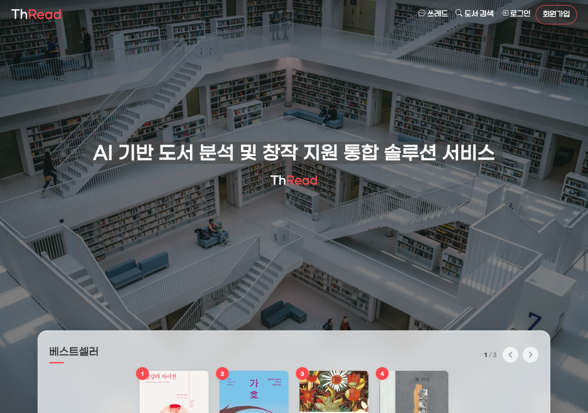 | 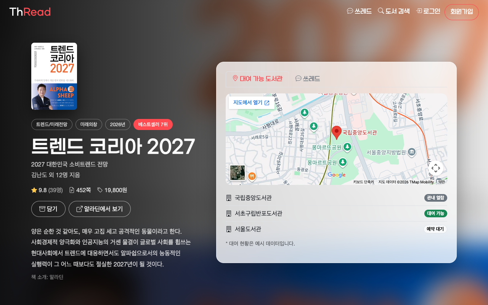 |

<br>

## 1️⃣2️⃣ 도서 데이터 · 상세 페이지 · 검색

- 📌 알라딘 베스트셀러와 지정 도서를 `import_books` 명령으로 가져와 DB에 저장하고, 페이지는 DB만 읽음 (응답 수 ms, 키가 만료돼도 동작)
- 📌 상세 페이지는 템플릿 하나로 모든 책(`/books/<isbn13>/`)에 적용되고, 배경은 그 책의 표지를 흐리게 깔아 책마다 색감이 달라짐
- 📌 도서 검색은 Navbar 오버레이에서 시작하며, 같은 검색은 하루 동안 캐시. 장르 타일을 누르면 해당 분야 베스트셀러로 이동

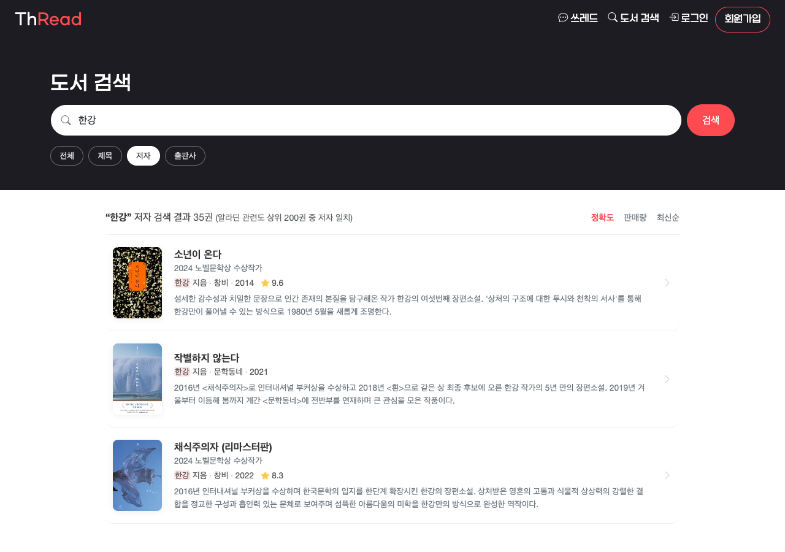

**🧗 어려웠던 점**

- 알라딘 API가 검색 범위(`QueryType`: 제목·저자·출판사)를 무시하고 항상 전체 결과를 돌려줬다. 관련도 상위 200권을 50권씩 4번 **동시에** 받아 직접 걸러내는 방식으로 해결했다. (순서대로 받으면 약 7초 → 약 2초)
- 가짜 ISBN(`0000000000000`)으로 조회하자 중고 매물이 저장됐다. ISBN 체크 숫자 검증과 중고 상품 제외를 추가했다.

<br><br>

## 1️⃣3️⃣ 회원 · 쓰레드 · 마이페이지

| 쓰레드 상세 (좋아요) | 마이페이지 (담은 책) | 로그인 |
| --- | --- | --- |
| 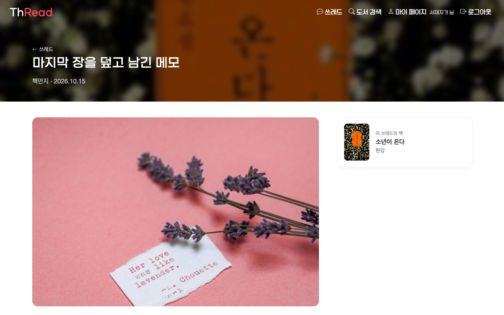 | 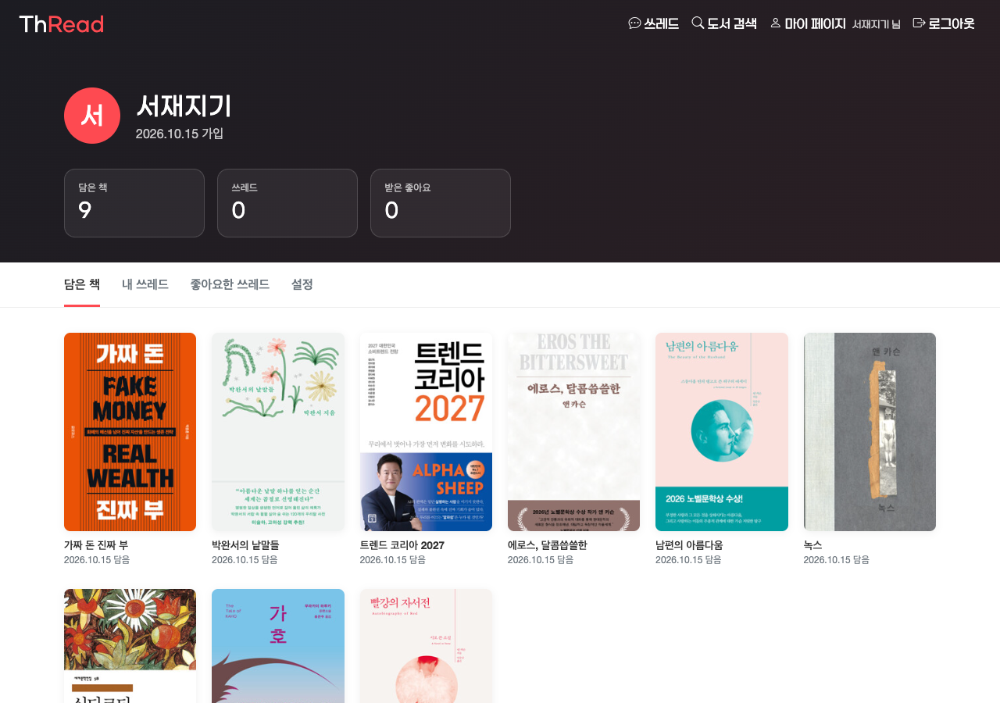 | 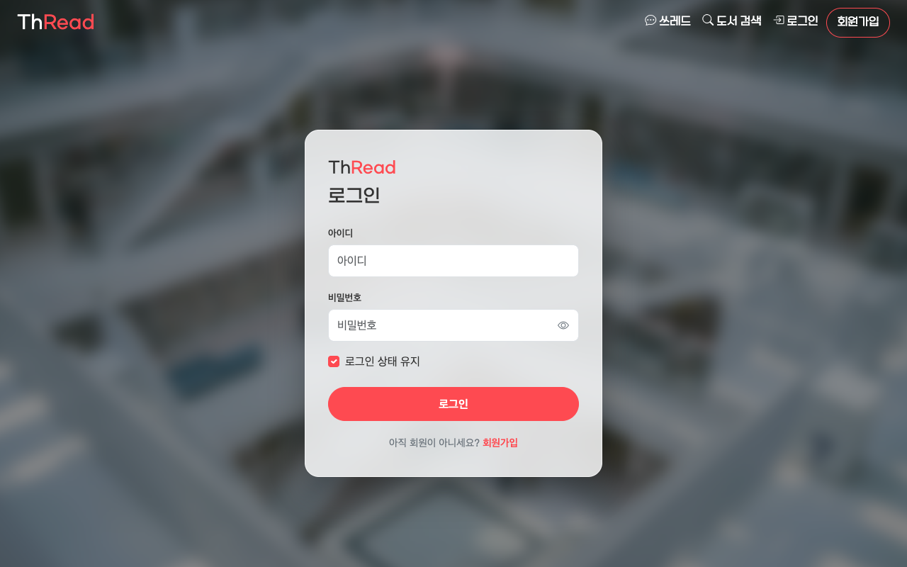 |

- 👤 **회원**: 커스텀 User(닉네임), 회원가입·로그인(로그인 유지)·로그아웃. 로그아웃은 Django 5 규칙에 맞게 POST 폼으로 바꿈
- 🧵 **쓰레드**: 책 한 권에 연결된 글을 작성·수정·삭제(작성자만)하고, 이미지를 첨부하고, 좋아요를 새로고침 없이 누를 수 있음
- 📚 **마이페이지**: 담은 책·내 쓰레드·좋아요한 쓰레드·설정(닉네임·비밀번호 변경, 회원 탈퇴) 탭

**🧗 어려웠던 점**

- 로그아웃 상태에서 좋아요를 누르면 CSRF 쿠키가 없어 403이 났다. 상세 페이지에 `@ensure_csrf_cookie`를 붙여 로그인 안내(401)가 나오게 했다.
- 사용자를 삭제하면 쓰레드는 함께 지워지지만 이미지 파일이 남았다. `delete()` 대신 모든 삭제에서 실행되는 `post_delete` 신호로 파일을 정리했다.

<br><br>

## 1️⃣4️⃣ AI 도서 추천

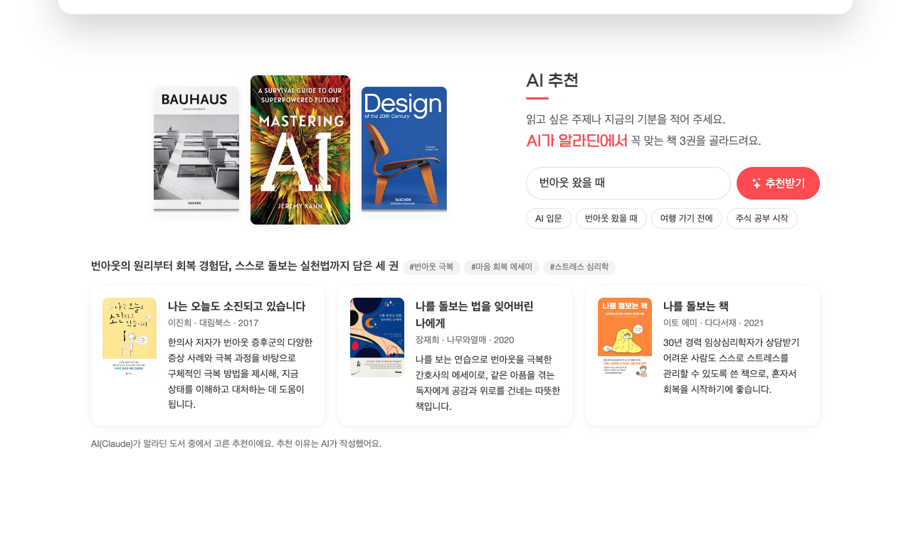

- 🤖 메인 "AI 추천"에 주제나 기분을 입력하면, Claude가 알라딘 검색어를 만들고 → 알라딘 후보 최대 50권 중 3권을 골라 추천 이유를 씀
- ✅ Claude가 고른 ISBN이 후보 목록에 있는지 서버에서 다시 확인해, **존재하지 않는 책은 추천되지 않음**
- ⚡ 같은 검색어 결과는 하루 동안 저장해 공유하고(처음 약 9초 → 이후 즉시), 새 추천은 1분에 3번으로 제한해 크레딧을 아낌

**🧗 어려웠던 점**

- Claude가 책 이름을 직접 말하게 하면 없는 책이나 최신이 아닌 책이 섞일 수 있다. "알라딘 후보 안에서만 고르기 + 서버 검증"으로 바꿨다.
- 응답을 기다리는 10초 동안 페이지가 멈추지 않도록, 메인은 바로 그리고 추천 영역만 fetch로 따로 불러오며 로딩 카드를 보여줬다.

<br>

---

<br>

## 💡 배운 점

| 주제 | 배운 점 |
| --- | --- |
| 🌐 외부 API | 페이지마다 API를 부르지 말고 DB에 저장해 두면 빠르고, 키가 만료돼도 서비스가 유지된다 |
| 🔒 보안 | CSRF·작성자 확인·HTML 이스케이프는 화면이 아니라 서버에서 지켜야 한다 |
| 🤖 생성형 AI | 결과를 그대로 믿지 않고, 정해진 형식(JSON 스키마)으로 받고 서버에서 다시 검증한다 |
| 🧪 테스트 | 외부 API는 가짜 응답(mock)으로 바꿔 테스트하면 네트워크·크레딧 없이 77개 테스트를 약 10초 만에 돌릴 수 있다 |

<br>

---

<br>

## 🤝 회고

<!-- 직접 작성 -->

<br>

---

<br>

## ⚠️ 실행 시 참고사항

- 🖼️ F311의 배경 이미지(`assets/book_detail/book_cover.jpg`)는 제공되지 않아 베스트셀러 표지로 대체했습니다. 원본을 받으면 CSS 변수 `--cover`의 경로만 바꾸면 됩니다.
- 🗺️ 도서관 대여 현황은 **예시 데이터**입니다.
- 🔐 Django 버전의 `.env`(API 키)는 git에 올리지 않습니다. 양식은 `skeleton/backend/.env.example`에 있습니다.

<br>
