<div align="center">

# 🔐 04-pjt

### Django Authentication System으로 만드는 📚 도서 커뮤니티 인증 페이지

AI 기반 도서 분석과 창작 지원 통합 솔루션 서비스의 인증 시스템을 구성하는 단계로, <br>
도서 데이터 CRUD와 회원가입 · 로그인 · 로그아웃 · 회원정보수정 · 비밀번호 변경 · 회원탈퇴를 구현한 프로젝트

<br>


`2026.10.29`

<br>

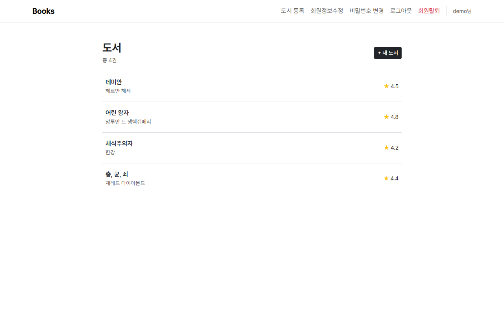

</div>

<br>

## 🗂️ 진행 범위

| 구분 | 요구사항 | 상태 |
| :---: | --- | :---: |
| **필수 (기능)** | F401 · F402 · F403 · F404 · F405 · F406 · F407 · F408 · F409 · F410 · F411 · F412 · F413 · F414 · F415 · F416 | ✅ 완료 |
| **필수 (비기능)** | NF401 · NF402 | ✅ 완료 |
| **심화** | F417 · F418 · F419 | ⬜ 미진행 |

<br>

## 🎯 목표

- 데이터를 생성, 조회, 수정, 삭제할 수 있는 Web application을 제작한다.
- Django Model과 ORM에 대하여 이해한다.
- Django Form에 대하여 이해한다.
- Django Authentication System에 대하여 이해한다.

<br>

## 🧰 사용 기술

| 구분 | 내용 |
| --- | --- |
| 🐍 언어 · 프레임워크 | Python 3.11 · Django 5.2 LTS · SQLite |
| 🎨 화면 | HTML · CSS · Bootstrap 5.3.3 · Pretendard 폰트 |
| 📦 라이브러리 | `django-bootstrap5` (폼을 Bootstrap 스타일로 출력) |
| 🛠️ 도구 | Visual Studio Code · Google Chrome |

<br>

## 📁 프로젝트 구조

```
04-pjt/
├── 📂 live_code/                         # 수업 실습 코드 (todo_pjt)
└── 📂 skeleton/
    ├── 📂 mypjt/                         # 프로젝트 설정 (settings.py, urls.py)
    ├── 📂 accounts/                      # 회원 앱
    │   ├── 📄 models.py                  # F402 User(AbstractUser)
    │   ├── 📄 forms.py                   # F403 CustomUserCreationForm · CustomUserChangeForm
    │   ├── 📄 views.py                   # F406 ~ F411
    │   ├── 📄 urls.py
    │   └── 📂 templates/accounts/        # login · signup · update · change_password
    ├── 📂 books/                         # 도서 앱
    │   ├── 📄 models.py                  # F404 Book
    │   ├── 📄 forms.py                   # F405 BookForm
    │   ├── 📄 views.py                   # F412 ~ F416
    │   ├── 📄 urls.py
    │   └── 📂 templates/books/           # index · create · detail · update
    ├── 📂 templates/
    │   └── 📄 base.html                  # 공통 레이아웃 + Navbar
    ├── 📂 screenshots/                   # 실행 화면 캡처 (pc_* · mobile_*)
    ├── 📋 requirements.txt
    └── 🙈 .gitignore
```

<br>

## 🚀 실행 방법

**1️⃣ 가상환경 생성 및 패키지 설치**

```bash
cd skeleton
python -m venv venv
source venv/Scripts/activate      # Mac: source venv/bin/activate
pip install -r requirements.txt
```

**2️⃣ DB 생성 및 서버 실행**

```bash
python manage.py migrate
python manage.py runserver
```

**3️⃣ 접속**

http://127.0.0.1:8000/books/ 에서 시작합니다. 회원가입 후 도서를 등록할 수 있습니다.

<br>

## 🗺️ URL 구성

| URL | name | view | 허용 Method |
| --- | --- | --- | :---: |
| `/books/` | `books:index` | 도서 목록 | GET |
| `/books/create/` | `books:create` | 도서 등록 | GET · POST |
| `/books/<pk>/` | `books:detail` | 도서 상세 | GET |
| `/books/<pk>/update/` | `books:update` | 도서 수정 | GET · POST |
| `/books/<pk>/delete/` | `books:delete` | 도서 삭제 | POST |
| `/accounts/login/` | `accounts:login` | 로그인 | GET · POST |
| `/accounts/logout/` | `accounts:logout` | 로그아웃 | POST |
| `/accounts/signup/` | `accounts:signup` | 회원가입 | GET · POST |
| `/accounts/update/` | `accounts:update` | 회원정보수정 | GET · POST |
| `/accounts/delete/` | `accounts:delete` | 회원탈퇴 | POST |
| `/<user_pk>/password/` | `change_password` | 비밀번호 변경 | GET · POST |

<br>

## 📱 반응형 기준

명세에는 화면 크기 기준이 없지만, PC와 모바일 모두에서 자연스럽게 보이도록 Bootstrap 기본 breakpoint만 사용해 구성했습니다.

| 구간 | 폭 | 주요 변화 |
| --- | --- | --- |
| 📱 모바일 | 768px 미만 | Navbar 메뉴가 햄버거 버튼 안으로 접힘, 폼 버튼이 화면 폭을 꽉 채움 |
| 🖥️ PC | 768px 이상 | Navbar 메뉴 한 줄 펼침, 본문 최대 760px · 폼 최대 420px로 가운데 정렬 |

<br>

## 🎨 공통 디자인

흰 배경 + 검정 포인트 + 얇은 구분선만 쓰는 **미니멀한 스탠다드 스타일**로 통일했습니다.

| 항목 | 값 |
| --- | --- |
| 폰트 | Pretendard (`word-break: keep-all`로 한글 단어 단위 줄바꿈) |
| 주요 버튼 | `btn-dark` 하나로 통일, 삭제 · 탈퇴만 빨간색 |
| 폼 출력 | `` 한 줄로 라벨 · 입력칸 · 에러 메시지 출력 |
| 확인창 | 도서 삭제 · 회원탈퇴 버튼은 누르기 전에 `confirm()`으로 한 번 더 확인 |

<br>

---

<br>

# ✅ 필수 과제

<br>

## 1️⃣ F401 · NF401 · NF402 · 프로젝트 구성

> 🎯 `F401` `NF401` `NF402` · `mypjt/` · `templates/base.html`

| PC (로그아웃 상태) | 모바일 (메뉴 펼침) |
| --- | --- |
| 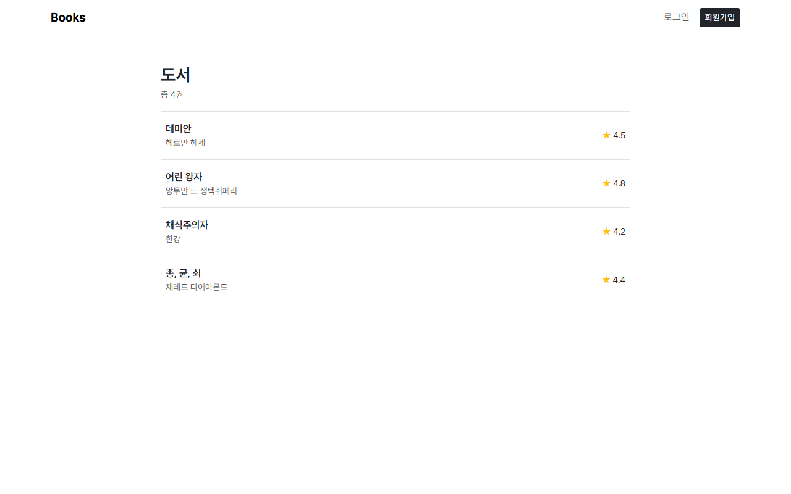 | 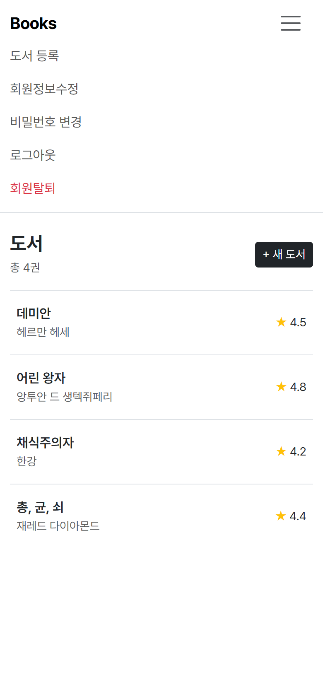 |

**🛠️ 구현 내용**

- 프로젝트 `mypjt`, 앱 `accounts` · `books` 생성
- `base.html`에 Navbar를 두고 모든 페이지가 ``로 상속 → 어느 페이지에서든 같은 메뉴로 이동 가능
- ``로 로그인 여부에 따라 메뉴 변경
  - 로그인 전: 로그인 · 회원가입
  - 로그인 후: 도서 등록 · 회원정보수정 · 비밀번호 변경 · 로그아웃 · 회원탈퇴
- **NF401**: 앱마다 `app_name`을 두고 모든 path에 `name`을 붙여, 템플릿과 view에서는 ``처럼 이름으로만 URL을 참조
- **NF402**: view마다 `require_safe` · `require_POST` · `require_http_methods`로 허용 Method를 제한

**📌 학습 포인트**

- URL을 문자열로 직접 쓰지 않고 `name`으로 참조하면, 주소가 바뀌어도 `urls.py` 한 곳만 고치면 된다.
- 허용되지 않은 Method로 요청하면 Django가 자동으로 `405 Method Not Allowed`를 돌려준다.

**🧗 어려웠던 점**

- `INSTALLED_APPS`에서 `'books'` 뒤 쉼표를 빠뜨려 `No module named 'booksdjango'` 에러가 났다. Python은 쉼표 없이 붙은 문자열을 하나로 합치기 때문에 `'books' 'django.contrib.admin'`이 `'booksdjango.contrib.admin'`이 됐다.

<br><br>

## 2️⃣ F402 · F403 · accounts Model & Form

> 🎯 `F402` `F403` · `accounts/models.py` · `accounts/forms.py`

**🛠️ 구현 내용**

- `AbstractUser`를 상속받은 `User` 모델을 만들고 `settings.py`에 `AUTH_USER_MODEL = 'accounts.User'` 지정
- 상황에 맞게 Django 기본 Form과 커스텀 Form을 나눠 사용

| 기능 | 사용한 Form |
| --- | --- |
| 회원가입 | `CustomUserCreationForm` (`UserCreationForm` 상속) |
| 회원정보수정 | `CustomUserChangeForm` (`UserChangeForm` 상속) |
| 로그인 | `AuthenticationForm` (Django 기본) |
| 비밀번호 변경 | `PasswordChangeForm` (Django 기본) |

```python
class CustomUserChangeForm(UserChangeForm):
    # 비밀번호 해시 정보는 출력하지 않고, 비밀번호 변경 페이지 링크로 대체
    password = None

    class Meta(UserChangeForm.Meta):
        model = get_user_model()
        fields = ('email', 'first_name', 'last_name',)
```

**📌 학습 포인트**

- `AUTH_USER_MODEL`은 **첫 `migrate` 전에** 지정해야 한다. 이후에 바꾸면 기존 테이블과 관계가 꼬여 DB를 새로 만들어야 한다.
- `UserCreationForm` · `UserChangeForm`은 Meta의 model이 Django 기본 `User`로 고정되어 있어서, 커스텀 User를 쓰려면 상속받아 `get_user_model()`로 바꿔줘야 한다.

**🧗 어려웠던 점**

- 회원가입 폼에 비밀번호 칸이 나오지 않았다. `CustomUserCreationForm`이 실수로 `UserChangeForm`을 상속하고 있었다. 비밀번호 입력칸(`password1`, `password2`)은 `UserCreationForm`에만 있다.
- `fields`를 `fiels`로 잘못 써서 설정이 무시되고, 회원정보수정 페이지에 권한 · staff 여부 같은 필드까지 전부 출력됐다. 오타 하나로 에러 없이 보안 문제가 생길 수 있다는 걸 알게 됐다.
- `UserChangeForm`의 `password` 필드는 Meta `fields`에 없으면 "비밀번호가 설정되지 않습니다"라고 잘못 표시되고, 넣으면 해시 알고리즘 · 솔트 정보가 화면에 출력됐다. 일반 사용자에게 보여줄 필요가 없는 정보라서 `password = None`으로 필드를 빼고, 페이지 아래에 비밀번호 변경 링크를 따로 넣었다.

<br><br>

## 3️⃣ F404 · F405 · books Model & Form

> 🎯 `F404` `F405` · `books/models.py` · `books/forms.py`

**🛠️ 구현 내용**

- `Book` 모델에 도서 제목 · 설명 · 회원 리뷰 평점 · 저자 4개 필드 지정

```python
class Book(models.Model):
    title = models.CharField(max_length=100)
    description = models.TextField()
    customer_review_rank = models.FloatField()
    author = models.CharField(max_length=50)
```

- `BookForm`은 `ModelForm`으로 만들어 검증 · 저장 · 에러 메시지를 Django에 맡김
- Meta의 `labels`로 라벨을 한글로, `widgets`로 설명은 6줄 textarea, 평점은 0 ~ 5 / 0.1 단위 숫자 입력으로 지정

**📌 학습 포인트**

- 짧은 문자열은 `CharField`(`max_length` 필수), 긴 글은 `TextField`, 소수 평점은 `FloatField`처럼 데이터 성격에 맞게 필드를 고른다.
- 모델의 `verbose_name`을 바꾸면 마이그레이션이 생기지만, Form의 `labels`는 화면 표시만 바꾸므로 DB에 영향이 없다.

**🧗 어려웠던 점**

- Meta의 `model`을 `moedl`로 잘못 써서 도서 등록 페이지에서 `ModelForm has no model class specified` 에러가 났다.

<br>

---

<br>

## 4️⃣ F406 · login

> 🎯 `F406` · `accounts/views.py`

| 로그인 | 로그인 실패 |
| --- | --- |
| 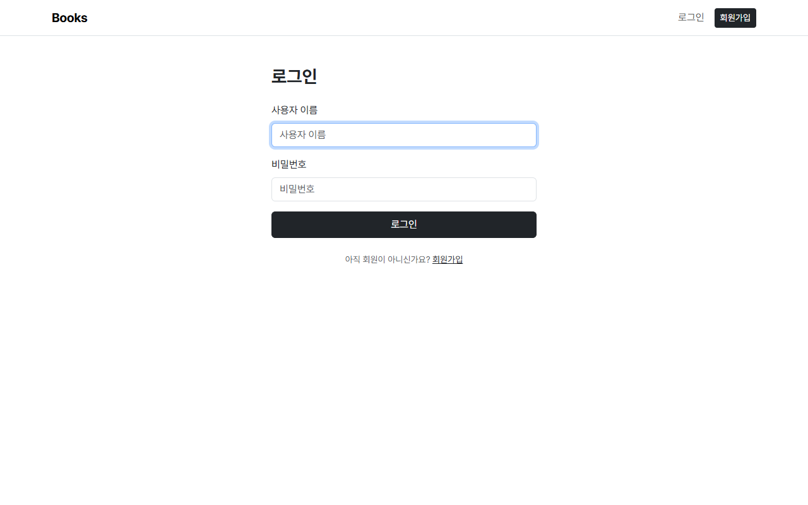 | 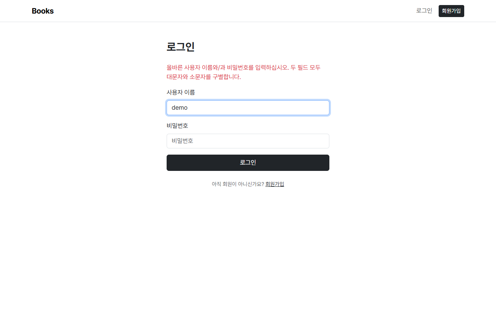 |

**🛠️ 구현 내용**

- 하나의 view에서 GET이면 로그인 페이지, POST면 `AuthenticationForm(request, request.POST)`로 검증 후 `auth_login`
- 로그인 성공 시 도서 목록(홈)으로 이동, 실패 시 폼 상단에 에러 메시지 표시
- 이미 로그인한 사용자가 접근하면 홈으로 이동

**📌 학습 포인트**

- `AuthenticationForm`은 다른 ModelForm과 달리 **첫 번째 인자로 `request`**를 받는다.
- 로그인은 "세션을 만들고 쿠키에 세션 ID를 저장하는 것"이고, `auth_login`이 이 과정을 처리한다.

<br><br>

## 5️⃣ F407 · logout

> 🎯 `F407` · `accounts/views.py`

**🛠️ 구현 내용**

- `require_POST`로 POST 요청에만 동작하고, `auth_logout`으로 세션 삭제 후 홈으로 이동
- Navbar의 로그아웃은 링크가 아니라 `<form method="POST">` 버튼

**📌 학습 포인트**

- 로그아웃처럼 서버 상태를 바꾸는 요청을 GET 링크로 만들면, 다른 사이트의 `` 한 줄만으로도 사용자를 로그아웃시킬 수 있다. 그래서 POST + CSRF 토큰으로 보호한다.

<br><br>

## 6️⃣ F408 · signup

> 🎯 `F408` · `accounts/views.py`

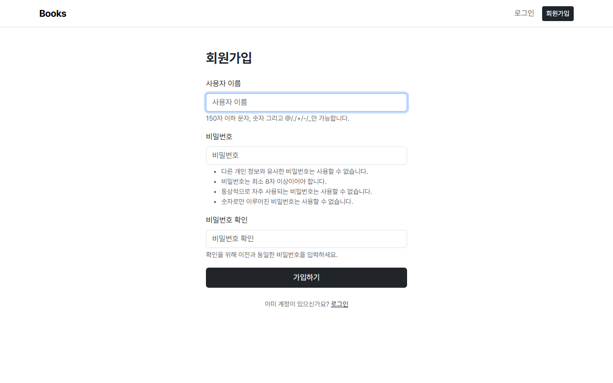

**🛠️ 구현 내용**

- 하나의 view에서 GET이면 회원가입 페이지, POST면 `CustomUserCreationForm`으로 검증
- 유효하면 `user = form.save()`로 회원을 만들고 바로 `auth_login(request, user)` 후 홈으로 이동

**📌 학습 포인트**

- `UserCreationForm`의 `save()`는 비밀번호를 **해시해서** 저장하고 생성된 User 객체를 돌려준다. 이 객체를 그대로 `auth_login`에 넘기면 가입과 동시에 로그인된다.

<br><br>

## 7️⃣ F409 · update

> 🎯 `F409` · `accounts/views.py`

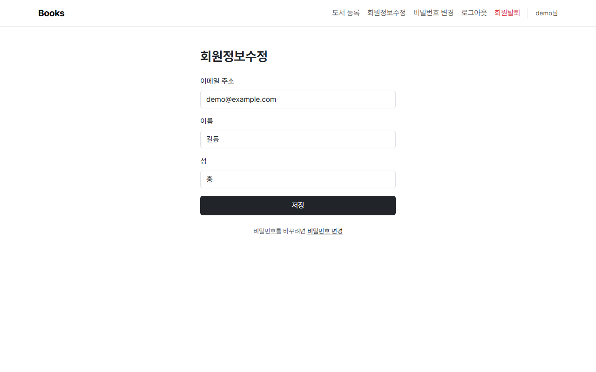

**🛠️ 구현 내용**

- `login_required`로 로그인한 사용자만 접근
- `CustomUserChangeForm(request.POST, instance=request.user)`로 현재 사용자 정보를 수정하고 홈으로 이동
- 이메일 · 이름 · 성만 출력해서 권한 · 가입일 같은 정보는 보이지 않음

<br><br>

## 8️⃣ F410 · delete

> 🎯 `F410` · `accounts/views.py`

**🛠️ 구현 내용**

- `require_POST`로 POST 요청에만 동작
- `request.user.delete()` 후 `auth_logout`으로 세션까지 정리하고 홈으로 이동
- 실수로 탈퇴하지 않도록 버튼을 누르면 확인창 표시

**📌 학습 포인트**

- 회원 삭제 → 로그아웃 순서로 처리한다. 삭제만 하면 DB에는 사용자가 없는데 세션이 남아 있는 상태가 된다.

<br><br>

## 9️⃣ F411 · change_password

> 🎯 `F411` · `accounts/views.py`

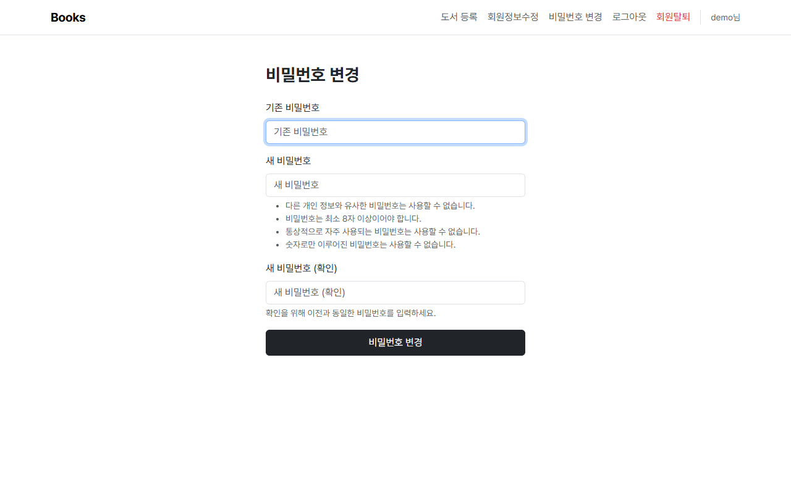

**🛠️ 구현 내용**

- Navbar의 "비밀번호 변경" 메뉴와 회원정보수정 페이지 하단 링크로 이동
- `PasswordChangeForm(request.user, request.POST)`로 기존 비밀번호 확인 + 새 비밀번호 검증
- 변경 후 `update_session_auth_hash`로 로그인 상태 유지, 홈으로 이동

```python
user = form.save()
update_session_auth_hash(request, user)  # 비밀번호를 바꿔도 로그아웃되지 않게
```

**📌 학습 포인트**

- 세션에는 비밀번호 해시로 만든 값이 함께 저장된다. 비밀번호가 바뀌면 이 값이 달라져 세션이 무효화되므로, `update_session_auth_hash`로 세션을 새 비밀번호 기준으로 갱신해야 한다.
- URL을 `/<user_pk>/password/`로 프로젝트 `urls.py`에 둔 이유는, Django 기본 회원정보수정 폼이 제공하는 비밀번호 링크가 `../../<pk>/password/` 형태의 상대경로이기 때문이다.

<br>

---

<br>

## 🔟 F412 · index

> 🎯 `F412` · `books/views.py`

| PC (로그인 후) | 모바일 |
| --- | --- |
|  | 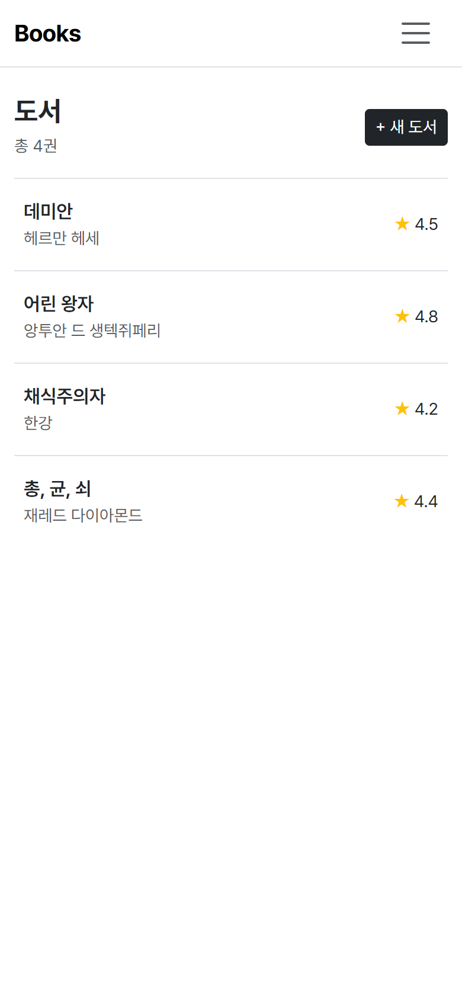 |

**🛠️ 구현 내용**

- `Book.objects.all()`로 전체 도서 조회, 제목 · 저자 · 평점을 행 단위로 출력
- 행 전체가 상세 페이지 링크
- 로그인한 경우에만 `+ 새 도서` 버튼 표시, 도서가 없으면 안내 문구 출력

<br><br>

## 1️⃣1️⃣ F413 · create

> 🎯 `F413` · `books/views.py`

| 도서 등록 | 빈 값으로 제출 |
| --- | --- |
| 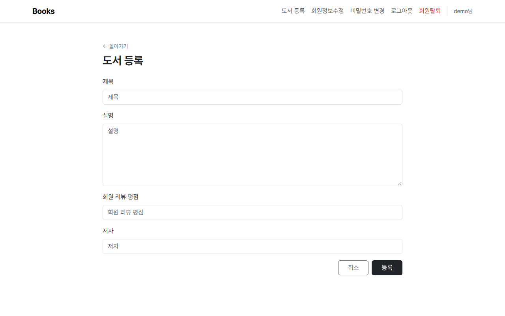 | 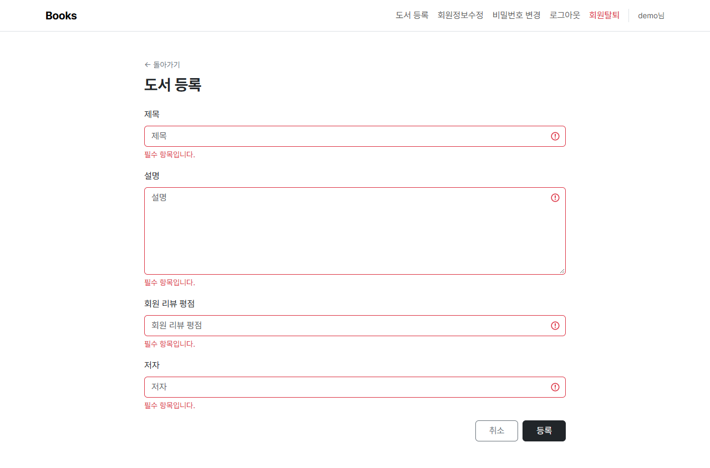 |

**🛠️ 구현 내용**

- `login_required`로 로그인한 사용자만 접근
- 하나의 view에서 GET이면 빈 폼, POST면 `BookForm`으로 검증 후 저장하고 상세 페이지로 이동
- 형식에 맞지 않으면 저장하지 않고 입력칸 아래에 에러 메시지 표시

**📌 학습 포인트**

- 폼에 `novalidate`를 주면 브라우저의 기본 검증 말풍선이 뜨지 않아서, **서버(Django Form)의 검증 결과**가 화면에 그대로 출력되는 것을 확인할 수 있다.

<br><br>

## 1️⃣2️⃣ F414 · detail

> 🎯 `F414` · `books/views.py`

| PC | 모바일 |
| --- | --- |
| 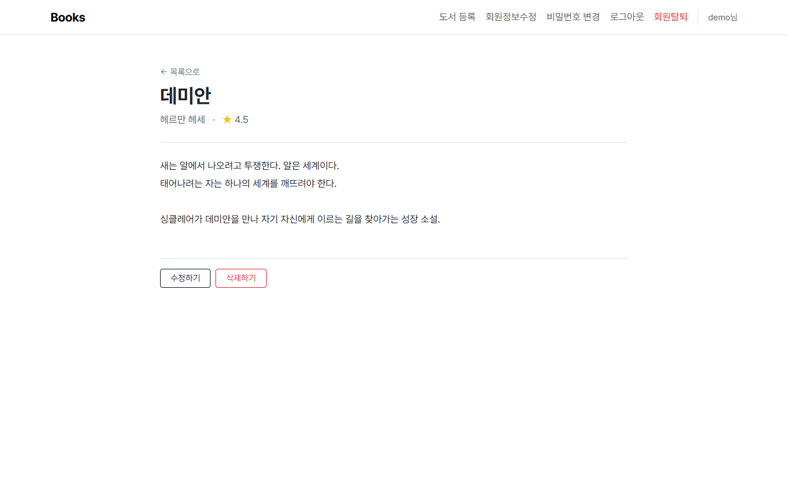 | 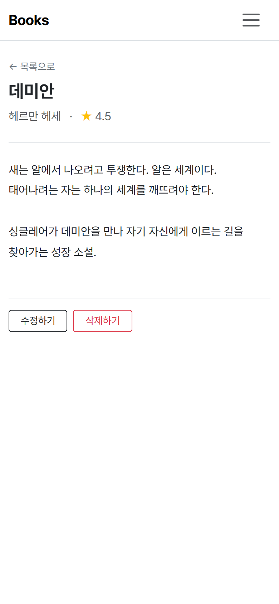 |

**🛠️ 구현 내용**

- `get_object_or_404`로 도서를 조회해 제목 · 저자 · 평점 · 설명 출력 (없는 번호면 404)
- 설명은 `linebreaksbr` 필터로 줄바꿈 유지
- 수정하기 링크, 삭제하기 버튼(POST 폼), 목록으로 링크 제공

<br><br>

## 1️⃣3️⃣ F415 · update

> 🎯 `F415` · `books/views.py`

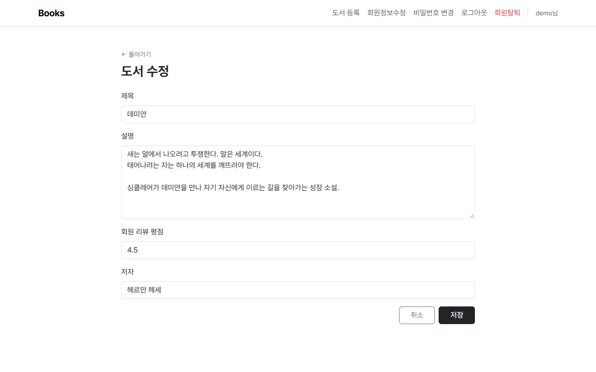

**🛠️ 구현 내용**

- `login_required`로 로그인한 사용자만 접근
- `BookForm(instance=book)`으로 기존 데이터가 미리 채워진 폼 출력
- POST면 `BookForm(request.POST, instance=book)`으로 검증 후 수정하고 상세 페이지로 이동

**📌 학습 포인트**

- `instance`를 넘기지 않으면 `save()`가 수정이 아니라 **새 도서를 생성**한다.

<br><br>

## 1️⃣4️⃣ F416 · delete

> 🎯 `F416` · `books/views.py`

**🛠️ 구현 내용**

- `require_POST`로 POST 요청에만 동작, 삭제 후 홈으로 이동
- 로그인하지 않은 사용자는 로그인 페이지로 이동

**📌 학습 포인트**

- delete에는 `@login_required`를 쓰지 않고 view 안에서 `request.user.is_authenticated`로 확인했다. `login_required`는 로그인 후 `?next=` 주소로 **GET** 요청을 보내는데, delete는 POST만 허용하므로 405 에러가 나기 때문이다.

<br>

---

<br>

## 📝 명세 외에 추가·결정한 사항

| 항목 | 결정 | 이유 |
| --- | --- | --- |
| 폼 스타일 | `django-bootstrap5` 사용 | `{{ form.as_p }}`는 Bootstrap 클래스가 붙지 않음. 템플릿마다 필드를 직접 반복하지 않아도 됨 |
| 언어 · 시간대 | `LANGUAGE_CODE = 'ko-kr'`, `TIME_ZONE = 'Asia/Seoul'` | Django 기본 폼의 라벨 · 도움말 · 에러 메시지가 한글로 출력됨 |
| 회원정보수정의 비밀번호 영역 | `password = None`으로 제거, 비밀번호 변경 링크로 대체 | 해시 정보는 일반 사용자에게 불필요한 정보 |
| 입력칸 초록색 표시 | CSS로 `is-valid` 스타일 제거 | 로그인 실패 시에도 입력칸에 초록 체크가 떠서 혼란스러움 |
| 삭제 · 탈퇴 확인창 | `confirm()` 추가 | 되돌릴 수 없는 동작이라 실수 방지 |
| 반응형 | Navbar `navbar-expand-md` + 햄버거 메뉴 | 로그인 후 메뉴가 6개라 모바일 한 줄에 들어가지 않음 |

<br>

---

<br>

## 💡 배운 점

| 주제 | 배운 점 |
| --- | --- |
| 🔐 인증 | 로그인 = 세션 생성, 로그아웃 = 세션 삭제. Django는 `auth_login` · `auth_logout` · `update_session_auth_hash`로 이 과정을 감싸 준다 |
| 🧾 Form | 회원가입 · 수정은 커스텀 Form, 로그인 · 비밀번호 변경은 기본 Form처럼 상황에 맞게 골라 쓴다. `instance` 유무로 생성과 수정이 갈린다 |
| 🛡️ 보안 | 상태를 바꾸는 요청(로그아웃, 삭제, 탈퇴)은 POST + CSRF로만 받고, 허용 Method는 데코레이터로 제한한다 |
| 🐞 디버깅 | `fiels`, `moedl`, 빠진 쉼표처럼 **에러 없이 조용히 무시되는 오타**가 가장 찾기 어렵다. 화면에 예상과 다른 것이 보이면 설정 철자부터 확인한다 |

<br>

---

<br>

## 🤝 회고

<!-- 직접 작성 -->

<br>

---

<br>

## ⚠️ 실행 시 참고사항

- 🗃️ `db.sqlite3`는 git에 올리지 않으므로, 처음 실행할 때 `python manage.py migrate`가 필요합니다.
- 📸 로그아웃 · 회원탈퇴 · 도서 삭제는 별도 화면 없이 바로 홈으로 이동하는 기능이라 캡처가 없습니다.
- 📱 모바일 캡처는 390px 폭(iPhone 기준)으로 찍었습니다. 전체 캡처는 `skeleton/screenshots/`에 있습니다.

<br>
