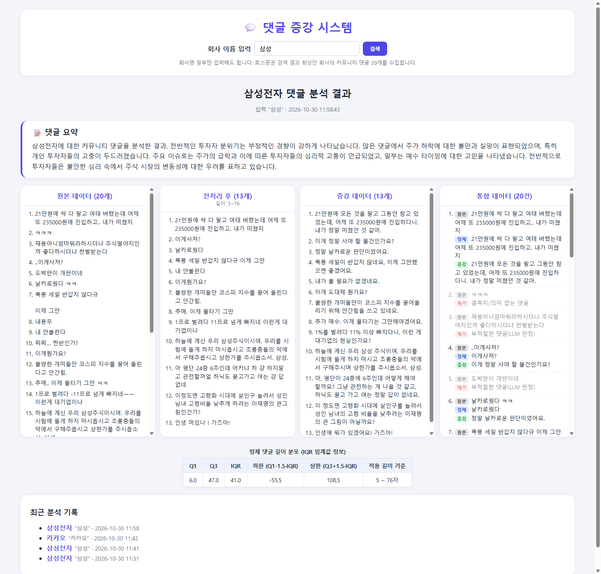
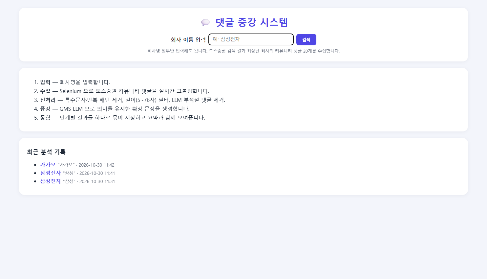
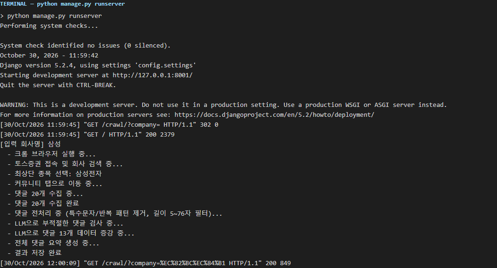
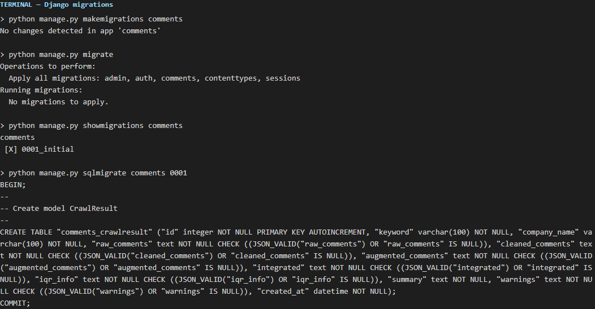
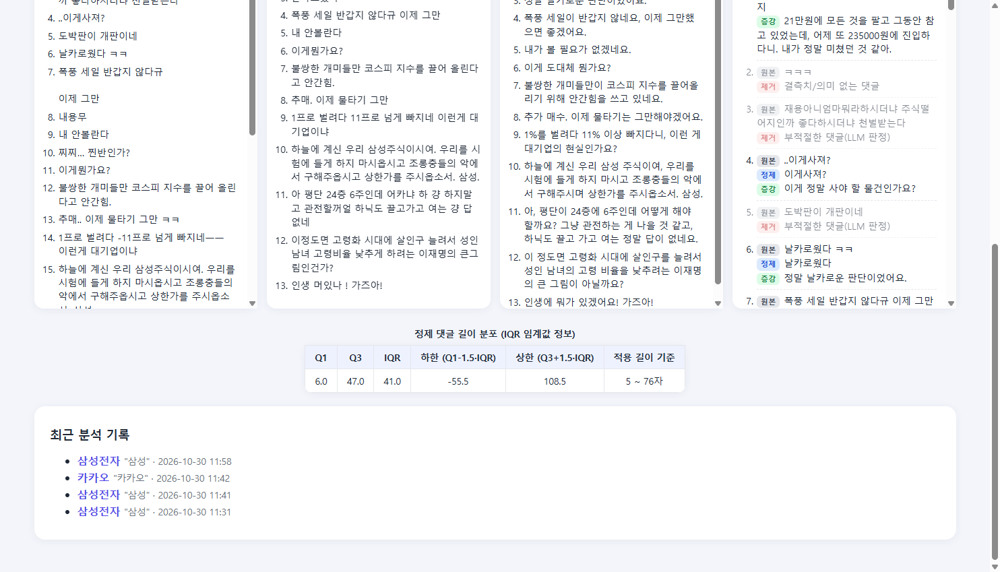
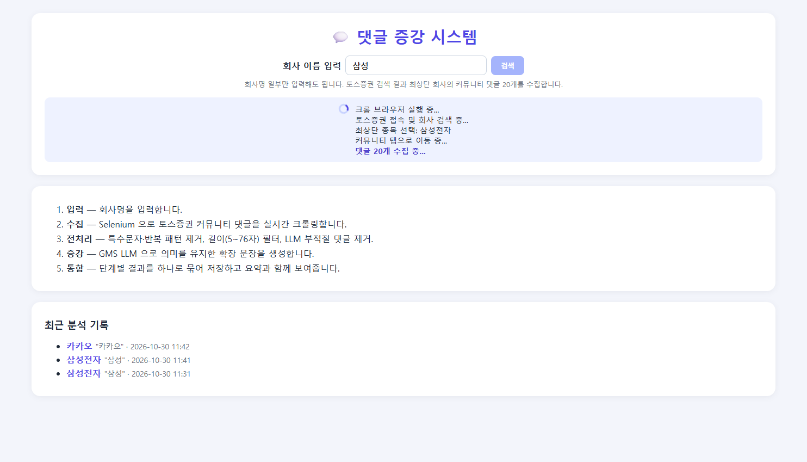
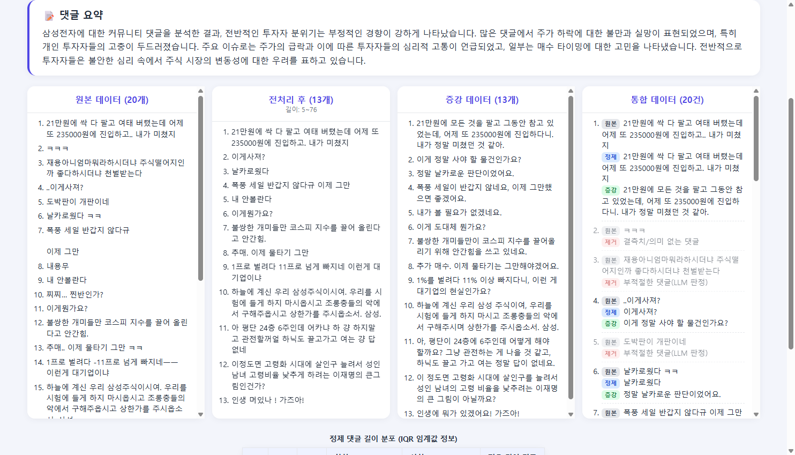
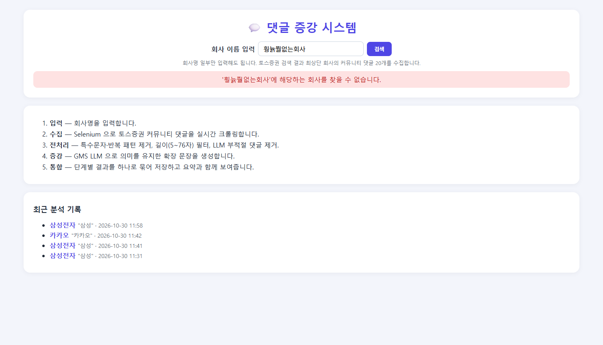

<div align="center">

# 🕷️ 05-pjt

### Selenium 크롤링과 LLM으로 만드는 💬 주식 커뮤니티 댓글 증강 시스템

Django 서버에서 **토스증권 커뮤니티 댓글을 실시간 크롤링**하고, 정규식 전처리와 <br>
**GMS LLM 기반 필터링 · 증강 · 요약**을 거쳐 단계별 결과를 하나의 화면과 DB에 통합하는 프로젝트

<br>


`2026.10.30`

<br>



</div>

<br>

## 🗂️ 진행 범위

| 구분 | 요구사항 | 상태 |
| :---: | --- | :---: |
| **필수** | F601 · F602 · F603 · F604 · F605 · F606 · F607 | ✅ 완료 |
| **심화** | F610 · F611 | ✅ 완료 |

<br>

## 🎯 목표

- Selenium으로 동적 웹 페이지의 데이터를 크롤링한다.
- 정규식으로 텍스트 데이터를 전처리하고 길이 분포를 통계적으로 확인한다.
- 생성형 AI(LLM)를 활용해 데이터를 필터링 · 증강 · 요약한다.
- 입력 → 처리 → 출력 단계를 Django 서비스로 통합하고 결과를 DB에 저장한다.

<br>

## 🧰 사용 기술

| 구분 | 내용 |
| --- | --- |
| 🐍 언어 · 프레임워크 | Python 3.11 · Django 5.2 LTS · SQLite |
| 🕷️ 크롤링 | Selenium · webdriver-manager (Chrome) |
| 🤖 LLM | `openai` SDK + SSAFY GMS (`gpt-4o-mini`) |
| 🎨 화면 | HTML · CSS · JavaScript (`fetch` + `ReadableStream`) |
| 📦 기타 | `python-dotenv` (`.env`에서 GMS 키 로드) |
| 🛠️ 도구 | Visual Studio Code · Google Chrome |

<br>

## 🔄 처리 흐름

```
입력(회사명) → 크롤링(Selenium) → 전처리(정규식 + 길이 + LLM 필터) → 증강(LLM) → 통합 저장/출력 (+ 요약)
```

<br>

## 📁 프로젝트 구조

```
05-pjt/
├── 📂 live_code/                         # 수업 실습 코드 (정적/동적 크롤링, 전처리, 증강, 파이프라인)
└── 📂 skeleton/
    ├── 📂 config/                        # 프로젝트 설정 (.env 로드)
    ├── 📂 comments/                      # 댓글 분석 앱
    │   ├── 📄 models.py                  # F602 CrawlResult — 단계별 결과 통합 저장
    │   ├── 📄 views.py                   # index · crawl(스트리밍) · result
    │   ├── 📄 urls.py
    │   ├── 📂 services/                  # 단계별로 분리한 처리 모듈
    │   │   ├── 📄 crawler.py             # F603 · F604 Selenium 크롤러
    │   │   ├── 📄 preprocess.py          # F605 정규식 정제 · 길이 필터 · IQR
    │   │   ├── 📄 llm.py                 # F605 · F606 · F610 부적절 판정 · 증강 · 요약
    │   │   └── 📄 pipeline.py            # F607 전체 파이프라인 (진행 상황 yield)
    │   ├── 📂 templates/comments/        # base · index · result
    │   └── 📂 static/comments/           # app.js (스트리밍 수신) · style.css
    ├── 📂 screenshots/                   # 실행 화면 캡처
    ├── 📋 requirements.txt
    ├── 🔑 .env.example
    └── 🙈 .gitignore
```

<br>

## 🚀 실행 방법

**1️⃣ 가상환경 생성 및 패키지 설치**

```bash
cd skeleton
python -m venv venv
source venv/Scripts/activate      # Mac: source venv/bin/activate
pip install -r requirements.txt
```

**2️⃣ 환경 변수 설정**

```bash
cp .env.example .env              # GMS_KEY 값 입력
```

**3️⃣ DB 생성 및 서버 실행**

```bash
python manage.py migrate
python manage.py runserver
```

**4️⃣ 접속**

http://127.0.0.1:8000/ 에서 회사명을 입력하고 검색합니다. Chrome이 설치되어 있어야 하며, ChromeDriver는 Selenium Manager / webdriver-manager가 자동으로 관리합니다.

<br>

## 🗺️ URL 구성

| URL | name | view | 설명 |
| --- | --- | --- | --- |
| `/` | `comments:index` | `index` | 회사명 입력 + 최근 분석 기록 |
| `/crawl/?company=<회사명>` | `comments:crawl` | `crawl_stream` | 파이프라인 실행, 진행 상황을 NDJSON으로 스트리밍 |
| `/results/<pk>/` | `comments:result` | `result` | 저장된 분석 결과 출력 |
| `/admin/` | - | Django admin | `CrawlResult` 관리 |

<br>

---

<br>

# ✅ 필수 과제

<br>

## 1️⃣ F601 · 회사명 입력 및 검증

> 🎯 `F601` · `comments/views.py` · `templates/comments/index.html`

| 입력 화면 | 빈 값으로 검색 |
| --- | --- |
|  |  |



**🛠️ 구현 내용**

- 회사명 입력창 제공, "삼성"처럼 일부 문자열만 입력해도 검색 가능
- 공백 · 빈 값이면 클라이언트와 서버 모두 아무 동작도 하지 않음 (서버는 `strip()` 후 비어 있으면 홈으로 리다이렉트)
- 입력 시 서버 터미널에 `[입력 회사명] 삼성`과 진행 단계를 출력

```python
keyword = request.GET.get("company", "").strip()
if not keyword:
    # 입력값이 없으면 아무 동작도 하지 않는다 (F601)
    return redirect("comments:index")

print(f"[입력 회사명] {keyword}")
```

**📌 학습 포인트**

- 클라이언트 검증은 사용자 편의를 위한 것이고, 요청은 언제든 직접 보낼 수 있으므로 **서버에서도 한 번 더 검증**해야 한다.

<br><br>

## 2️⃣ F602 · DB 스키마 구성

> 🎯 `F602` · `comments/models.py`

| 마이그레이션 | 저장된 IQR 정보 |
| --- | --- |
|  |  |

**🛠️ 구현 내용**

- 한 번의 크롤링 요청에 대한 단계별 결과를 `CrawlResult` 하나에 통합 저장

| 필드 | 타입 | 내용 |
| --- | --- | --- |
| `keyword` · `company_name` | `CharField` | 입력 회사명 · 실제 종목명 |
| `raw_comments` · `cleaned_comments` · `augmented_comments` | `JSONField` | 원본 · 정제 · 증강 댓글 목록 |
| `integrated` | `JSONField` | 원본 댓글별 `{original, cleaned, augmented, removed_reason}` |
| `iqr_info` | `JSONField` | Q1 · Q3 · IQR · 상하한 · 적용 길이 기준 |
| `summary` | `TextField` | 댓글 요약 (F610) |
| `warnings` | `JSONField` | LLM 단계 생략 경고 |
| `created_at` | `DateTimeField` | 생성 일시 (최신순 정렬) |

**📌 학습 포인트**

- 댓글 목록처럼 개수가 정해지지 않은 데이터는 `JSONField`로 저장하면 별도 테이블 없이 단계별 결과를 그대로 보관할 수 있다.

<br><br>

## 3️⃣ F603 · 회사 검색 및 선택 + 진행 상황 스트리밍

> 🎯 `F603` · `services/crawler.py` · `views.py` · `static/comments/app.js`



**🛠️ 구현 내용**

- 토스증권 메인 → 검색창("/를 눌러 검색하세요") 클릭 → 회사명 입력 → 자동 포커싱된 최상단 결과를 Enter로 선택
- 실제 종목명은 `og:title` 메타 태그에서 추출 ("삼성" → "삼성전자"), 실패 시 탭 제목에서 추출
- `StreamingHttpResponse`로 NDJSON 진행 이벤트를 전송하고, 프론트엔드가 `fetch` + `ReadableStream`으로 실시간 표시

```python
def stream():
    for event in run_pipeline(keyword):
        yield json.dumps(event, ensure_ascii=False) + "\n"

response = StreamingHttpResponse(stream(), content_type="application/x-ndjson; charset=utf-8")
```

**📌 학습 포인트**

- 파이프라인을 진행 메시지를 `yield`하는 **제너레이터**로 설계하면 `StreamingHttpResponse`에 그대로 연결할 수 있다.
- 크롤러도 제너레이터로 만들고, 최종 결과(종목명, 댓글 목록)는 `return` 값으로 돌려준 뒤 `StopIteration.value`로 받았다.

<br><br>

## 4️⃣ F604 · 커뮤니티 댓글 수집

> 🎯 `F604` · `services/crawler.py`

**🛠️ 구현 내용**

- 종목 상세의 커뮤니티 탭 클릭 후 가상 스크롤 목록을 내려가며 게시글 ID 기준으로 중복 없이 20개 수집
- 긴 글 끝에 붙는 "더 보기" 문구 제거
- 5번 연속 새 게시글이 없으면 수집 종료

**📌 학습 포인트**

- 해시된 CSS 클래스 대신 `data-section-name`, `data-post-anchor-id` 같은 **의미 있는 속성**으로 셀렉터를 잡아야 안정적이다.

**🧗 어려웠던 점**

- 가상 스크롤 목록은 스크롤할 때마다 DOM이 다시 그려져 `StaleElementReferenceException`이 계속 발생했다. `execute_script` 한 번으로 **읽기와 스크롤을 원자적으로** 처리해 해결했다.

<br><br>

## 5️⃣ F605 · 댓글 정제

> 🎯 `F605` · `services/preprocess.py` · `services/llm.py`

**🛠️ 구현 내용**

- 정규식으로 단계별 정제 후 길이 5 ~ 76자 필터 → LLM으로 부적절 댓글 번호(JSON 배열) 판정 후 제거
- 제거된 댓글은 버리지 않고 **제거 사유**를 함께 기록

| 패턴 | 제거 대상 |
| --- | --- |
| `URL_PATTERN` | `http://...`, `www...` 링크 |
| `JAMO_PATTERN` | ㅋㅋ · ㅎㅎ · ㅠㅠ 같은 자모 반복 |
| `SPECIAL_PATTERN` | 이모지 · 특수기호 (한글 · 영문 · 숫자 · 기본 문장부호 제외) |
| `REPEAT_PUNCT_PATTERN` | `!!!!`, `~~~~`, `....` 같은 반복 문장부호 |
| `SPACE_PATTERN` | 연속 공백 |

- 정제된 댓글 길이 분포로 IQR(Q1 · Q3 · 상하한)을 계산해 함께 저장

**📌 학습 포인트**

- 정규식을 하나로 뭉치지 않고 목적별 패턴으로 나누면, 어떤 단계에서 무엇이 지워졌는지 확인하고 고치기 쉽다.

<br><br>

## 6️⃣ F606 · 텍스트 증강

> 🎯 `F606` · `services/llm.py`

**🛠️ 구현 내용**

- 남은 댓글 각각을 원래 의미와 감정(긍정/부정)을 유지한 자연스러운 문장으로 LLM 증강
- 응답을 JSON 문자열 배열로 받아, 입력과 **개수가 다르면 실패로 처리**

**📌 학습 포인트**

- LLM 응답에 ```` ```json ```` 코드블록이 섞여도 정규식으로 배열 부분만 추출해 파싱했다. LLM 출력은 형식을 강제하고 검증까지 해야 프로그램에서 안전하게 쓸 수 있다.

<br><br>

## 7️⃣ F607 · 데이터 통합

> 🎯 `F607` · `services/pipeline.py` · `templates/comments/result.html`


**🛠️ 구현 내용**

- 원본 댓글별로 `원본 → 정제 → 증강` 또는 `제거 사유`를 묶은 통합 레코드를 DB에 저장
- 결과 화면을 원본 / 전처리 / 증강 / 통합 4열로 출력

<br>

---

<br>

# 🔥 심화 과제

<br>

## 8️⃣ F610 · 댓글 요약

> 🎯 `F610` · `services/llm.py`



**🛠️ 구현 내용**

- 전체 댓글을 바탕으로 투자 분위기 · 주요 이슈 · 핵심 의견을 3 ~ 4문장으로 요약해 결과 상단에 표시

<br><br>

## 9️⃣ F611 · 예외 안내

> 🎯 `F611` · `services/crawler.py` · `services/pipeline.py`



**🛠️ 구현 내용**

| 상황 | 처리 |
| --- | --- |
| 검색 결과 없음 | "'회사명'에 해당하는 회사를 찾을 수 없습니다." 안내 |
| 댓글 없음 | 해당 종목의 커뮤니티 댓글이 없다고 안내 |
| 페이지 로딩 시간 초과 | 잠시 후 다시 시도하라고 안내 |
| 브라우저 오류 | `WebDriverException` 메시지 안내 |
| GMS 키 누락 · 호출 실패 | 해당 LLM 단계만 생략하고 경고 표시, 나머지 결과는 정상 저장 |

**📌 학습 포인트**

- 사용자에게 보여줄 실패는 `CrawlError`, LLM 실패는 `LLMUnavailable`처럼 **예외를 종류별로 나누니** 단계마다 다르게 대응할 수 있었다.

<br>

---

<br>

## 📝 명세 외에 추가·결정한 사항

| 항목 | 결정 | 이유 |
| --- | --- | --- |
| 진행 상황 표시 | NDJSON 스트리밍 | 크롤링 + LLM 호출이 수십 초 걸려서, 기다리는 동안 어느 단계인지 보여주기 위함 |
| 최근 분석 기록 | 홈 · 결과 화면에 최근 10건 표시 | 같은 회사를 다시 크롤링하지 않고 이전 결과를 바로 확인 |
| 제거 사유 표시 | 통합 레코드에 `removed_reason` 저장 | 어떤 댓글이 왜 빠졌는지 확인 가능 |
| IQR 정보 | 길이 분포 표로 출력 | 5 ~ 76자 기준이 실제 분포와 비교해 적절한지 확인 |
| 드라이버 관리 | Selenium Manager 우선, 실패 시 webdriver-manager | Chrome 버전에 맞는 드라이버를 자동으로 준비 |
| GMS 키 관리 | `.env` + `python-dotenv` | 키가 git에 올라가지 않도록 분리 |
| 관리자 | Django admin 등록 | 저장된 결과를 DB 단위로 확인 |

<br>

---

<br>

## 💡 배운 점

| 주제 | 배운 점 |
| --- | --- |
| 🕷️ 동적 크롤링 | 해시 클래스명 대신 의미 있는 속성으로 셀렉터를 잡고, 가상 스크롤은 JS 한 번으로 읽고 스크롤해야 안정적이다 |
| 🌊 스트리밍 응답 | 제너레이터로 설계하면 `StreamingHttpResponse`에 그대로 연결되고, 최종 결과는 `StopIteration.value`로 받을 수 있다 |
| 🧹 정규식 전처리 | 자모 반복 · URL · 이모지 · 반복 문장부호를 단계별 패턴으로 나눠 제거하고, 길이 분포를 IQR로 확인한다 |
| 🤖 LLM 활용 | 응답 형식을 JSON 배열로 강제하고, 배열만 추출해 파싱하고, 개수까지 검증해야 프로그램에서 안전하게 쓸 수 있다 |

<br>

---

<br>

## 🤝 회고

<br>

### 🔍 문서에 없는 페이지 구조를 직접 분석하기

실제 서비스 페이지를 크롤링하니 **문서에 없는 구조(가상 스크롤, 해시 클래스명)를 직접 분석하는 과정**이 가장 중요했습니다. 개발자 도구로 DOM을 살펴보며 바뀌지 않는 속성을 찾고, 스크롤할 때마다 요소가 다시 그려지는 문제를 해결하는 데 가장 많은 시간을 썼습니다.

<br>

### 🧩 단계를 나누니 원인을 찾기 쉬웠다

입력 → 크롤링 → 전처리 → 증강 → 저장 단계를 **독립 모듈**로 나누어 두니, LLM 키가 없거나 크롤링이 실패해도 어느 단계에서 문제가 생겼는지 바로 알 수 있었고 단계별로 다르게 대응하기도 쉬웠습니다.

<br>

---

<br>

## ⚠️ 실행 시 참고사항

- 🔑 `.env`에 `GMS_KEY`가 없으면 크롤링 · 전처리까지만 진행되고, LLM 단계(필터링 · 증강 · 요약)는 경고와 함께 생략됩니다.
- 🗃️ `db.sqlite3`는 git에 올리지 않으므로, 처음 실행할 때 `python manage.py migrate`가 필요합니다.
- 🌐 토스증권 페이지 구조가 바뀌면 `services/crawler.py`의 셀렉터를 수정해야 할 수 있습니다.
- 📸 전체 캡처는 `skeleton/screenshots/`에 있습니다.

<br>
